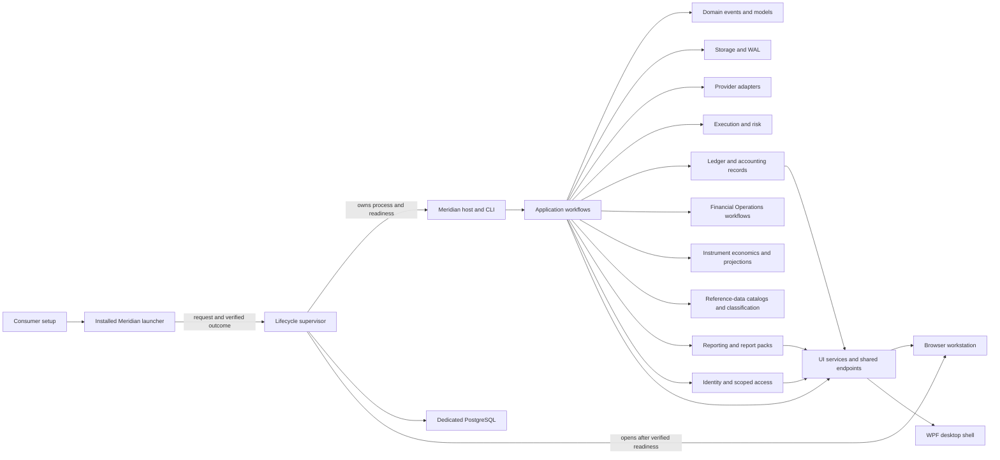
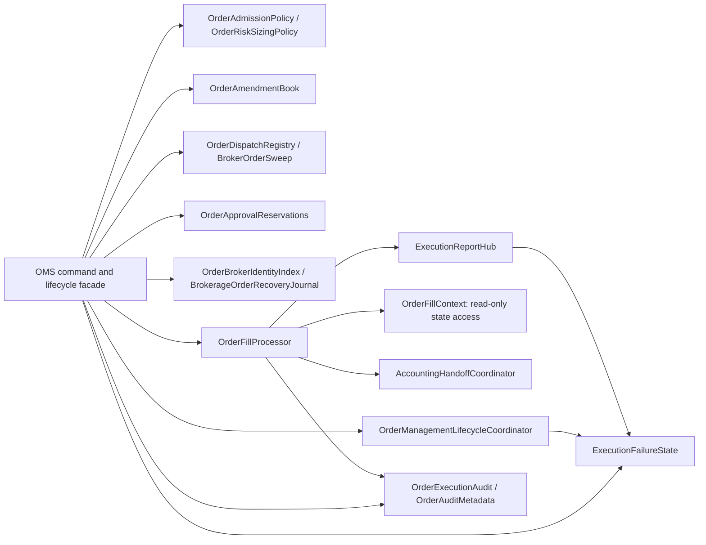

# Module Map

**Status:** Active
**Owner:** Core Team
**Reviewed:** 2026-10-30 (product-objective alignment; source ownership retained)

This map gives maintainers a quick layer-oriented view of Meridian.

The current [design charter](../product/meridian-design-document.md) covers financial operations,
strategy formulation and validation, order management, and governed strategy execution. These
objectives reuse the source owners below; naming them does not establish complete operator
coverage or release acceptance. Their additional delivery work is tracked under the
[expanded strategy and order-management objectives](../product/implementation-todo-list.md#expanded-strategy-and-order-management-objectives).

For complete product design document adaptation, use
[`design-document-adaptation.md`](design-document-adaptation.md). For the physical bounded-context
module structure, use [`design-module-conformance.md`](design-module-conformance.md). Together they
bridge design names such as `Meridian.FinancialOperations` to the current source projects listed
below.

## Runtime Flow

## Layer Responsibilities

| Layer | Projects | Rule |
| --- | --- | --- |
| Host | `src/Meridian` | Compose services, expose CLI/API modes, and host workstation endpoints |
| Installed runtime | `src/Meridian.Launcher`, `src/Meridian.LifecycleSupervisor`, `src/Meridian.Setup` | Setup installs the payload; the launcher verifies the request-bound startup outcome; the supervisor owns host/database processes, readiness, and browser opening |
| Application | `src/Meridian.Application` | Coordinate workflows; keep UI and provider specifics out |
| Domain/Core/Contracts | `src/Meridian.Domain`, `src/Meridian.Core`, `src/Meridian.Contracts` | Keep business and contract types UI-independent, including workstation, private-capital, reporting, and identity payloads consumed by multiple surfaces |
| Providers/Infrastructure | `src/Meridian.Infrastructure*`, `src/Meridian.ProviderSdk` | Isolate external API integration behind provider contracts |
| Storage | `src/Meridian.Storage` | Preserve WAL and atomic-write durability expectations |
| Execution/Risk | `src/Meridian.Execution*`, `src/Meridian.Risk` | Own order lifecycle and broker gateways, paper/live controls, execution recovery, and pre-trade validation within their published contracts |
| Accounting and Ledger | `src/Meridian.Ledger`, `src/Meridian.FSharp.Ledger` | Own ledger behavior, private-capital fund-event reconstruction, capital-account subledger impact, treasury ledger metadata, and accounting-record boundaries |
| Financial Operations | `src/Meridian.FinancialOperations` | Own close, reconciliation, accounting-basis workflows, and preparation of governed ledger instructions |
| Instruments | `src/Meridian.Instruments` | Own instrument economics, Security Master-keyed Asset Operations, cash-flow projections, and factor-paydown projections |
| Reference Data | `src/Meridian.ReferenceData` | Own asset-class/instrument-kind mapping, profile catalog contracts, and seeded approved asset-profile templates |
| Reporting | `src/Meridian.Reporting` | Own governed report-pack behavior, report-writer grids, filters, formulas, lineage, publication, restatement, and report-generation semantics |
| Identity and Access | `src/Meridian.Identity` | Own sessions, role profiles, scoped access, fund/account traversal authorization, and company-scoped user account/profile state |
| Strategy/Backtesting | `src/Meridian.Strategies`, `src/Meridian.Backtesting*`, `src/Meridian.QuantScript` | Keep strategy definitions, validation, run evidence, promotion, replay, and supported scripting reusable outside UI |
| UI Shared | `src/Meridian.Ui.Services`, `src/Meridian.Ui.Shared` | Own workstation DTO projection and endpoint/read-model support for accounting configuration, private-capital drill-through, report packs, auth/session adapters, and shared browser/WPF workflows |
| UI Surfaces | `src/Meridian.Ui/dashboard`, `src/Meridian.Wpf` | Keep views thin; put state, labels, disabled reasons, and commands in view models |

## Boundary Checks

- The installed launcher accepts only `start` and `open`. Maintenance commands go directly
  to `Meridian.LifecycleSupervisor.exe`; keep process ownership and readiness checks in the supervisor.
- Domain, core, storage, providers, execution, strategy, and backtesting projects
  must not depend on UI projects.
- Browser workstation logic should prefer view-model/read-model seams instead of
  hardcoding workflow state in React components.
- Browser workstation work and WPF desktop workstation work are two active co-equal operator UI lanes over shared contracts; WPF's current focus is web-UI parity (`W8-WPF-PARITY-001`).
- Browser and WPF surfaces should consume shared DTOs, services, and route definitions for strategy, order, accounting, reporting, private-capital, and identity workflows instead of duplicating business rules.
- Security Master query, command, resolver and live-position adjustment contracts are owned by
  `Meridian.Contracts.SecurityMaster`. Execution and Backtesting have no Application project
  reference. Identity, trading parameters and corporate actions have narrow query interfaces;
  the aggregate query inherits them for existing callers. Application owns implementations and
  deprecated compatibility bridges, with no parallel query interface.
- Typed schedule generation lives in `src/Meridian.Contracts/SecurityMaster/Schedules/`;
  open-lot factor-paydown contracts live in `src/Meridian.Contracts/Accounting/Lots/`.
  `src/Meridian.Instruments/AssetOperations/FactorPaydownProjectionService.cs` projects the economics,
  and `src/Meridian.FinancialOperations/Ledger/FactorPaydownLotInstructionService.cs` prepares the
  ledger and lot instructions. Application composition registers this preparation service, but no
  operator route calls it yet; composition does not establish workstation activation.
- Design tokens and shared UI patterns should come from the Meridian Design
  System or local shared dashboard primitives, not one-off screen styling.

## OMS Runtime Ownership and Lifecycle

`OrderManagementSystem` implements `IOrderManagementLifecycle` through its internal
`OrderManagementLifecycleCoordinator`. Construction restores retained
identity evidence without starting background work. `StartAsync` starts gateway-report intake and
retained accounting-handoff replay once; order operations require startup. `StopAsync` closes
admission and shares the existing asynchronous disposal drain, including admitted operations and
accepted fills. Cancellation stops the caller's wait, while disposal still waits for the drain.
A stopped instance cannot restart.

`AddBrokerageExecution` registers the hosted lifecycle owner for the resolved `IOrderManager`.
Direct callers must start the OMS explicitly and await stop/disposal before releasing its gateway
or accounting dependencies.

Internal collaborators under `Meridian.Execution/OrderManagement` now own bounded parts of the
runtime. The facade retains public commands, live order state and sidecars, the shared broker-report
and pre-trade reservation gates, and command/risk-reservation/amendment/cancellation/kill-switch
coordination. The lifecycle coordinator owns operation and subscription admission, worker lifetime,
and the shared shutdown drain.

The amendment book owns pending attempts, restored provenance, broker outcome evidence, and
exposure projections over the live order view. The facade applies its prepared transitions and
removes resolved attempts after fill processing succeeds. The dispatch registry owns in-flight
submission leases and bounded waits for a sweep's initial dispatch snapshot. The broker sweep
owns broker-book snapshots, cancellation-ID matching, residual cancellations, and their audit
evidence; tracked cancellations, concurrency, and final sweep outcomes stay with the facade.
Approval reservations own parked client identities and their escalation checks, rearming, and
withdrawal; the facade retains order/session effects and risk-capacity settlement.

The recovery journal owns durable checkpoints, permanent dispatched identities, tombstones, and
the recovery-version lock; the identity index owns active broker IDs and replacement aliases.
The fill processor owns progress and pending exposure while reading order ownership/sizing
through `OrderFillContext`. Accounting acceptance and replay belong to the handoff coordinator;
subscriber delivery and observer publication belong to the report hub. Admission and delivery
share the first terminal consumer failure. Audit helpers consume explicit snapshots.

The facade's shared report gate still protects live reports, recovery, amendment resolution, and
retention. Recovery checkpoint evidence still reads the pending flag and snapshot separately
inside the journal lock. The journal's guarded compaction persists the tombstone and performs
expected-state removal under one recovery lock; the facade then removes sidecars. Existing APIs,
persistence formats, alias and fill identity rules, and shutdown drain semantics are preserved.
Fill effects retain their order: portfolio application, accounting acceptance, session persistence,
authoritative delivery, then observer publication. These scoped ownership boundaries retain command
coordination in the facade. See the
[execution module README](../../src/Meridian.Execution/README.md#oms-ownership) for the detailed map.

## Operational Record Boundaries

The W1-W5 operational-record baseline establishes data confidence, retained evidence,
reconciliation, approvals, accounting, multi-asset coverage, and governed reporting invariants.
It is not a ceiling on the charter's strategy and OMS objectives. Shared ownership connects those
workflows without merging strategy intent, broker observations, portfolio projections, and posted
accounting into a competing source of truth:

- `src/Meridian.Contracts` declares shared workstation, ledger, private-capital, report-pack, report-writer, and identity-facing payloads and routes.
- `src/Meridian.Strategies` owns strategy definitions, scoped run history, promotion records, and strategy read services; supported evaluation and runtime behavior use the existing Backtesting and QuantScript seams.
- `src/Meridian.Execution` owns order commands, lifecycle, broker observations, recovery, and fill handoff through the OMS boundary above; `src/Meridian.Risk` owns pre-trade risk policy. A requested action or an accepted strategy result is not a broker confirmation or ledger posting.
- `src/Meridian.Ledger` reconstructs posted private-capital fund-event ledger state, capital-account subledger impact, treasury context, and period/report handoff metadata.
- `src/Meridian.FinancialOperations` owns accounting-close, reconciliation, accounting-record, approval, casework, and close-workflow semantics that coordinate ledger evidence into operational records.
- `src/Meridian.Reporting` renders governed report packs and no-code report-writer grids with saved filters, formulas, filtered-input counts, and lineage.
- `src/Meridian.Ui.Shared` adapts those source-owned services into endpoint/read-model support for the browser workstation and WPF shell.
- External GL and provider systems remain evidence inputs where configured; Meridian-owned ledger records, retained evidence, approvals, and report outputs are the operational record surface.
- Storage journal records, UI projections, report-pack links, and workflow records are intentionally separate persistence or presentation surfaces. They may carry source-owned identifiers, evidence links, state labels, and DTO snapshots, but they must not redefine posting rules, trial-balance math, close-readiness gates, reconciliation classifications, or accounting approval semantics outside `src/Meridian.Ledger` and `src/Meridian.FinancialOperations`.
- New accounting-like models outside the ledger or Financial Operations owners must be projection-, persistence-, reporting-, or workflow-specific, named for that role, and covered by the `AccountingSemanticBoundaryTests` allowlist so reviewers can distinguish intentional boundary surfaces from duplicated accounting semantics.

The [strategy, order, and execution dictionary](../domain/strategy-order-execution.md) defines the
shared business meanings. Current run/account/readiness admission and runtime-isolation limits
remain in force. A broader operator-directed order path needs its own reviewed authority contract;
it cannot manufacture a strategy run or bypass promotion, credential, risk, or live-control gates.

## Fund Structure Service Refactor Boundaries (Staged Migration)

- `IFundStructureService` remains the caller-facing application contract for UI/API layers.
- Command handling and workflow orchestration stay in `InMemoryFundStructureService` and `PostgresFundStructureService` so existing endpoint behavior and method contracts remain stable during migration.
- `FundStructureProjector` owns the shared, pure organization graph, legacy fund graph, advisory, fund operating, and accounting projections. Each service supplies a captured structure snapshot, authorized accounts, explicit effective time, and resolved shared-data metadata; the projector does not perform I/O or mutate state.
- Persistence concerns are now isolated behind `IFundStructureStateStore` with adapters:
  - `JsonFileFundStructureStateStore` for durable local snapshots.
  - `InMemoryFundStructureStateStore` for test/dev ephemeral state.
- Validation/policy rules that do not require storage are owned by `IFundStructurePolicyService` (`FundStructurePolicyService`) so PostgreSQL-backed services can reuse identical domain checks.
- During PostgreSQL adoption, new persistence adapters should implement dedicated persistence ports and be injected into orchestration services rather than embedding storage calls inside domain rule paths.

### Method Category Map (Current Fund Structure Services)

- `IFundStructureService`
  - Creation commands: `CreateOrganizationAsync`, `CreateBusinessAsync`, `CreateClientAsync`, `CreateFundAsync`, `CreateSleeveAsync`, `CreateVehicleAsync`, `CreateLegalEntityAsync`, `CreateInvestmentPortfolioAsync`.
  - Ownership lifecycle commands: `LinkNodesAsync`, `UpdateOwnershipLinkAsync`, `ExpireOwnershipLinkAsync`, `ReplaceOwnershipLinkAsync`, `ValidateOwnershipGraphAsync`.
  - Assignment commands: `AssignNodeAsync`.
  - Query projection: `GetOrganizationStructureAsync`, `GetFundStructureGraphAsync`, `GetAdvisoryViewAsync`, `GetFundOperatingViewAsync`, `GetAccountingViewAsync`, `GetCashFlowViewAsync`.
- `InMemoryFundStructureService`
  - Command handling: implements the full `IFundStructureService` creation, ownership lifecycle, validation, and assignment surface.
  - Query projection: delegates organization graph, legacy fund graph, advisory, fund operating, and accounting views to `FundStructureProjector`; delegates cash-flow orchestration to `FundStructureCashFlowReadService` with captured structure, visible accounts, shared metadata, and explicit effective time.
  - Validation/policy: delegates pure portfolio-parent rules to `IFundStructurePolicyService`; owns existence checks, ownership-link lifecycle checks, and cycle validation.
  - Workflow orchestration: parent-link creation, ownership projection rebuilds after link lifecycle changes, shared-data synchronization, cross-service composition with account/security-master services.
  - Storage concerns: snapshot capture/load/save via `IFundStructureStateStore`, including updated, expired, and replacement ownership links.
- `PostgresFundStructureService`
  - Command handling: implements the same `IFundStructureService` creation, ownership lifecycle, validation, and assignment surface over `IFundStructureStore`.
  - Query projection: delegates the same graph, advisory, fund operating, and accounting views to `FundStructureProjector` after loading and tenant filtering; cash-flow views use `FundStructureCashFlowReadService` with the same tenant-filtered account boundary, without constructing an in-memory command service.
  - Validation/policy: reuses `FundStructurePolicyService` for pure rules and service-local ownership existence/cycle validation for persisted links.
  - Workflow orchestration: loads a mutable snapshot, applies lifecycle mutations, rebuilds ownership projections, and upserts changed rows through the store.
  - Storage concerns: persists organizations, businesses, clients, funds, sleeves, vehicles, entities, portfolios, ownership links, and assignments via `IFundStructureStore`.
- `InMemoryFundAccountService` (peer)
  - Command handling: account creation/update/deactivation and reconciliation write flows.
  - Query projection: account query/read methods and filtered projections.
  - Validation/policy: account status policy (`EnsureAllowed`) and request invariants.
  - Workflow orchestration: account lifecycle sequencing around reconciliation and synchronization state.
  - Storage concerns: snapshot capture/load/save and in-memory aggregate persistence.

## Shared outstanding-principal calculation

`Meridian.Application/SecurityMaster/CashFlow/SecurityPrincipalBalance.cs` owns the
opening outstanding face used by calculated cash flows and quoted-price valuation.
Dated factors absorb principal through their evidence date; later completed principal
payments reduce the balance. Future-dated scalar factors do not price an earlier date,
and an undated current factor is not reduced twice. This calculation is separate from
posting a lot-factor paydown and does not activate its operator route.
