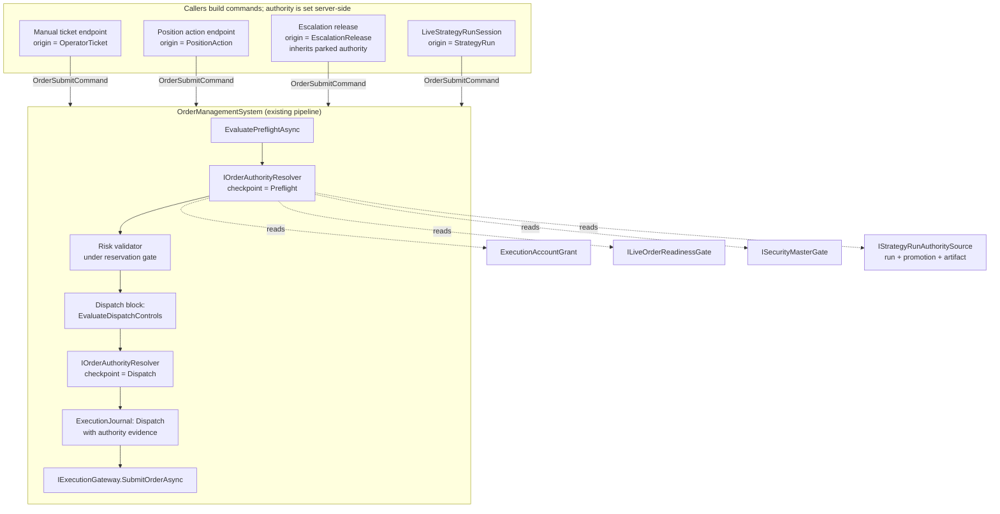

# Blueprint — Governed Order Command Boundary (Typed Authority, Rechecked at Dispatch)

**Status:** draft
**Owner:** Execution and Fund Accounts lane
**Reviewed:** 2026-11-17
**Depth mode:** full
**Registered in:** [`docs/engineering/blueprints/README.md`](README.md)
**Related roadmap item:** `W13-OMS-001` (Governed order management and broker execution workbench).
Covers its second and third exit criteria: the operator-intent / execution-account authority contract, and
"one authoritative OMS … rechecked at the authoritative command boundary; stale or incomplete authority
blocks dispatch."
**Companion blueprint:** [Versioned Strategy-Artifact Identity](strategy-artifact-identity-blueprint.md)
(`W13-STRAT-001`).
**Builds on, does not replace:** [Risk Engine: Severity-Aware Evaluation and Pre-Trade Decision Journal](risk-engine-severity-and-decision-journal-blueprint.md).

> This document is a design. It grants no roadmap acceptance, authorizes no live orders, and changes no
> `W13-OMS-001` status. Line references were checked against source on 2026-11-17.

---

## Reframing the brainstorm idea

The brainstorm proposed routing manual tickets and strategy orders "through the same submit path". The source
shows **that is already true.** Every production order source ends at
`OrderManagementSystem.PlaceOrderAsync`, and gateway bypass is blocked by design:

| Source | Entry point | Reaches OMS at |
| --- | --- | --- |
| Manual ticket (browser) | `POST /api/execution/orders/submit` (`Meridian.Ui.Shared/Endpoints/ExecutionEndpoints.cs:149`) | `:208` |
| Position close / upsize | `ExecutionEndpoints.Positions.cs:115` `SubmitPositionActionAsync` | `Positions.cs:229` |
| Risk escalation release | `RiskEndpoints.cs:264` `/escalations/{id}/approve` | `:387` |
| Strategy (paper / live run) | `LiveStrategyRunSession.DrainPendingOrders` (`Meridian.Strategies/Live/LiveStrategyRunSession.cs:561`) → `MapOrder` (`:923`) | `:578` |
| Direct gateway use | `OmsGovernedBrokerageOrderGateway` / `OmsGovernedExecutionOrderGateway` (`BrokerageServiceRegistration.cs:61-74`) | `SubmitAsync` throws |

So the real problem is not two paths. **One path carries authority as untyped, partly client-supplied
metadata, and most authority checks run only at preflight or only in the HTTP layer.** This blueprint
replaces that with a typed authority contract that the OMS itself resolves at preflight and resolves again at
dispatch.

### Gaps found in source

1. **A manual ticket can claim a strategy run's live authority.** The OMS reads `runId` from
   `request.Metadata` (`OrderAdmissionPolicy.Prepare`, `Meridian.Execution/OrderManagement/OrderAdmissionPolicy.cs:79`).
   The live readiness gate approves when that `runId` equals the promoted target run
   (`TradingOperatorLiveOrderReadinessGate.cs:62`). `runId` is **not** in
   `ExecutionOrderMetadataPolicy.ClientRejectedKeys` (`Meridian.Execution.Sdk/ExecutionOrderMetadataPolicy.cs:9-32`).
   The submit endpoint passes client metadata through and adds only `actor` and `correlationId`
   (`ExecutionEndpoints.cs:194-202`). An operator with `ManageOrders` and account access can therefore send a
   manual live ticket carrying the promoted run's id and have it admitted under that strategy's promotion. The
   roadmap states this must not happen: "missing strategy context cannot be filled with invented runs or
   bypassed gates." The browser ticket never sends `metadata` (`OrderSubmitRequest`,
   `src/Meridian.Ui/dashboard/src/types/workstation-3.ts:909`), so closing this does not affect the browser.
2. **Account authority is enforced only in the HTTP layer, and only when an account is supplied.**
   `RequireExecutionFundAccountAccessAsync` runs only `if (request.FundAccountId is { } …)`
   (`ExecutionEndpoints.cs:185`). Strategy orders take `FundAccountId` from the run (`MapOrder`) with no
   per-order authority check inside the OMS.
3. **Most checks are not repeated at dispatch.** Operator controls are rechecked at dispatch
   (`OrderManagementSystem.cs:390-421`), and so are market session and quote (`:516`). Live readiness, Security
   Master, and account authority run only in `EvaluatePreflightAsync`. A readiness snapshot that changes during
   a risk escalation, which can park for minutes, is not seen.
4. **Order origin is not typed.** The journal and audit cannot tell a manual ticket from a strategy order
   except by guessing from metadata keys.
5. **The OMS is composed in two places** (`Meridian.Execution/BrokerageServiceRegistration.cs:92` and
   `src/Meridian/UiServer.cs:432`) with slightly different required dependencies. Any new dependency has to be
   wired twice, or the two will drift.

---

## ⚠️ Breaking Change

| Surface | Change | Known consumers | Migration |
| --- | --- | --- | --- |
| `ExecutionOrderMetadataPolicy.ClientRejectedKeys` | Add `runId`, `run_id`, `sessionId`, `session_id`, `orderOrigin` | `POST /orders/submit`, `POST /orders/preview`, position actions (all via `TryRejectClientControlledExecutionMetadata` / `RemoveServerOwnedExecutionMetadata`) | Browser: none, because it sends no metadata. **Any script, MCP tool, or test that posts `runId` in ticket metadata now gets 403.** Search `tests/` and `src/Meridian.Mcp` for `"runId"` in order metadata before merging |
| `IOrderManager` | **Adds** `SubmitAsync(OrderSubmitCommand, CancellationToken)`. `PlaceOrderAsync(OrderRequest, …)` stays and becomes a compatibility shim | All callers in the table above; test doubles implementing `IOrderManager` | Test doubles must implement the new method. A default interface method that throws `NotSupportedException` keeps third-party fakes compiling |
| Manual live tickets (behavior) | Refused with `MANUAL_LIVE_INTENT_CONTRACT_NOT_REVIEWED` until a reviewed manual-intent authority exists (Decision 4) | Live-mode operators only | Paper and manual tickets are unaffected. Live manual orders that pass today only by borrowing a run id stop working, **by design** |
| `OrderResult` | Gains optional `AuthorityDecisionSummary` | Browser ticket result rendering | Additive |

No storage-format removals. Journal and audit entries gain fields; readers ignore unknown fields.

---

## Scope

**In scope**

- A typed `OrderSubmissionAuthority` attached to every submit, cancel, and replace command, built only on the
  server.
- `IOrderAuthorityResolver`: one OMS-internal component that checks origin, account grant, run/promotion
  binding, live readiness, and Security Master. It runs **twice**: at preflight and again at dispatch, inside
  the existing dispatch-control block.
- Moving fund-account authorization from "HTTP layer, optional" to "carried as a grant, verified inside the
  OMS, required".
- Typed order origin in the journal (`ExecutionJournal`) and the audit trail (`ExecutionAuditTrailService`).
- One `OrderManagementSystemFactory` used by both composition sites.
- Phase 0: closing the client-supplied `runId` gap, which can ship on its own.

**Out of scope**

- The reviewed manual-intent authority contract itself (W13-OMS-001, criterion 2). This blueprint fails
  closed and reserves the type slot. The contract needs its own product decision (Open Question 1).
- Indeterminate / disputed order states, the replay chaos suite, and cancel-all outcome reports
  (Order Management #2–#4).
- Broker capability matrix (Order Management #5). The resolver has an extension point for it.
- Idempotent retry semantics (return the prior result for a repeated client order id). Today a duplicate is
  rejected (`OrderManagementSystem.cs:201-215`); that stays.
- A WPF order ticket. None exists today. When it is built, it must post to the same REST route.

**Assumptions to verify**

1. No production caller other than `LiveStrategyRunSession` legitimately sets `runId` metadata. Grep confirms
   this for `src/`; `src/Meridian.Mcp` and the test suites need checking.
2. `ITradingOperatorReadinessProvider` exposes a snapshot version that is cheap to read. The gate already
   requires one (`TradingOperatorLiveOrderReadinessGate.cs:83`).
3. `ISecurityMasterGate.CheckAsync` is idempotent and cheap enough to call twice per order.

---

## Architectural Overview

### Context diagram



### Design decisions

- **Decision 1: Wrap the existing pipeline. Do not build a second one.**
  `SubmitAsync(OrderSubmitCommand)` becomes the primary entry point. `PlaceOrderCoreAsync` takes the
  resolved authority as a parameter instead of reading metadata. `PlaceOrderAsync(OrderRequest)` stays as a
  shim that builds an `Unattributed` authority.
  **Alternatives considered:** a new `OrderCommandService` in front of the OMS (this would make authority a
  caller-side concern again, which is the current problem); putting authority on `OrderRequest` (it is a
  JSON-bound REST body, so clients could set it).
  **Rationale:** Authority must be a parameter the HTTP model binder cannot fill. A separate command type
  achieves that by construction.
  **Consequences:** Every caller changes one line. The shim keeps tests and fakes compiling during migration.

- **Decision 2: Authority is resolved twice, at preflight and at dispatch.**
  The dispatch resolution runs inside the existing dispatch-lease block, right after
  `EvaluateDispatchControls` (`OrderManagementSystem.cs:390`). It reuses that block's refusal path:
  settle risk reservations with `commit: false`, restore consumed approvals, then `RejectOrderAsync`.
  **Rationale:** This is the exact pattern the codebase already uses for operator controls, for the same
  reason. Time passes between gate and dispatch, especially across a risk escalation park.
  **Cost control:** At dispatch, the resolver compares the readiness snapshot version and account-grant
  validity with what preflight saw. It runs the full readiness evaluation again only if the version changed.

- **Decision 3: Account authority is a grant resolved by the caller and verified by the OMS.**
  The HTTP layer is the only place that knows the principal, so it still resolves access. It now produces an
  `ExecutionAccountGrant` and **always** resolves an account: when the request names none, it uses the actor's
  default execution account, and if there is none it refuses. The OMS refuses any command whose grant is
  missing, names a different account than the order, or is older than `MaxGrantAge`.
  For `StrategyRun`, the grant is derived from the run's retained `FundAccountId` and checked against the
  promotion record by `IStrategyRunAuthoritySource`.
  **Alternatives considered:** having the OMS call the identity service itself (this would pull `HttpContext`
  concerns into `Meridian.Execution` and create a project-reference cycle).

- **Decision 4: Manual live tickets fail closed until a reviewed manual-intent contract exists.**
  `OperatorTicket` in Live mode returns `MANUAL_LIVE_INTENT_CONTRACT_NOT_REVIEWED`. The
  `ManualIntentAuthorization` slot on the authority record is reserved for that contract but has no issuer.
  **Rationale:** The roadmap requires the contract to be defined and reviewed *before* manual live orders are
  exposed. Today manual live orders are admitted only by borrowing a run id, which is gap 1.
  **Consequences:** No supported manual live path exists until Open Question 1 is resolved. Paper is
  unchanged.

- **Decision 5: Strategy orders bind run, promotion, and artifact.**
  The `StrategyRun` authority carries `RunId` and, once the companion blueprint lands, `StrategyArtifactId`.
  The resolver checks that the run is the promotion's `TargetRunId`, that the run is active (not stopped or
  faulted), and, when present, that the run's artifact id equals the promoted artifact id.

- **Decision 6: Escalation releases inherit the parked authority. They never re-derive it.**
  `RiskEscalationQueueService` already retains the parked request. It now also retains the
  `OrderSubmissionAuthority`. The release resubmits with origin `EscalationRelease`, the original authority
  nested, and the approver recorded. Dispatch rechecks the original authority, so a readiness change while the
  order was parked blocks it.

---

## Interface & API Contracts

### Assembly placement

Same rule as the risk-engine blueprint: if the OMS touches a type, the type cannot live in `Meridian.Risk` or
`Meridian.Ui.Shared`.

| Type | Assembly |
| --- | --- |
| `OrderCommandOrigin`, `OrderSubmissionAuthority`, `ExecutionAccountGrant`, `OrderSubmitCommand`, `OrderCancelCommand`, `OrderReplaceCommand`, `AuthorityDecisionSummary` | `Meridian.Execution.Sdk` |
| `IOrderAuthorityResolver`, `OrderAuthorityResolver`, `AuthorityCheckpoint`, `OrderAuthorityDecision`, `IStrategyRunAuthoritySource`, `OrderAuthorityOptions`, `OrderManagementSystemFactory` | `Meridian.Execution` |
| `StrategyRunAuthoritySource` (implements `IStrategyRunAuthoritySource`) | `Meridian.Strategies` (it reads the run store and promotion store) |
| `ExecutionAccountGrantResolver` (HTTP-side) | `Meridian.Ui.Shared` |

### Command and authority types (`Meridian.Execution.Sdk`)

```csharp
namespace Meridian.Execution.Sdk;

/// <summary>Who or what originated an order command. Set by the server, never deserialized from clients.</summary>
public enum OrderCommandOrigin
{
    Unattributed,       // legacy PlaceOrderAsync shim only; refused in Live mode
    OperatorTicket,
    PositionAction,
    EscalationRelease,
    StrategyRun,
    KillSwitch          // cancel-only
}

/// <summary>Proof that a principal may route orders for one fund account, resolved at the edge.</summary>
public sealed record ExecutionAccountGrant(
    Guid FundAccountId,
    string GrantedTo,                    // actor id
    string Source,                       // "http-principal" | "strategy-run" | "escalation"
    DateTimeOffset ResolvedAt);

/// <summary>Typed authority for one command. Constructed only through the static factories.</summary>
public sealed record OrderSubmissionAuthority
{
    public OrderCommandOrigin Origin { get; }
    public string Actor { get; }
    public ExecutionAccountGrant? AccountGrant { get; }
    public string? RunId { get; }
    public string? StrategyArtifactId { get; }
    public string CorrelationId { get; }
    public string? SessionId { get; }
    public OrderSubmissionAuthority? ReleasedFrom { get; }   // set only for EscalationRelease
    public string? ReleasedBy { get; }

    public static OrderSubmissionAuthority ForOperatorTicket(string actor, ExecutionAccountGrant grant, string correlationId, string? sessionId);
    public static OrderSubmissionAuthority ForPositionAction(string actor, ExecutionAccountGrant grant, string correlationId);
    public static OrderSubmissionAuthority ForStrategyRun(string actor, ExecutionAccountGrant grant, string runId, string? strategyArtifactId);
    public static OrderSubmissionAuthority ForEscalationRelease(OrderSubmissionAuthority parked, string approver);
    public static OrderSubmissionAuthority ForKillSwitch(string actor, string correlationId);
    internal static OrderSubmissionAuthority Unattributed(IReadOnlyDictionary<string, string>? legacyMetadata);
}

public sealed record OrderSubmitCommand(OrderRequest Order, OrderSubmissionAuthority Authority);
public sealed record OrderCancelCommand(string OrderId, OrderSubmissionAuthority Authority);
public sealed record OrderReplaceCommand(string OrderId, OrderModification Modification, OrderSubmissionAuthority Authority);

/// <summary>Returned on OrderResult so the ticket can show which authority admitted or refused it.</summary>
public sealed record AuthorityDecisionSummary(
    OrderCommandOrigin Origin, bool IsAuthorized, string? ReasonCode, string? Reason,
    string Checkpoint, string? ReadinessSnapshotVersion, string? PromotionAuditReference);
```

`OrderSubmissionAuthority` has no public constructor and no `[JsonConstructor]`. It is serialized for the
journal and the escalation queue through a source-generated context, using an internal
`OrderSubmissionAuthorityRecord` DTO (ADR-014).

### IOrderManager (additive)

```csharp
public interface IOrderManager
{
    // existing members unchanged …

    /// <summary>Primary entry point. Authority is resolved at preflight and again at dispatch.</summary>
    Task<OrderResult> SubmitAsync(OrderSubmitCommand command, CancellationToken ct = default)
        => throw new NotSupportedException("This order manager does not support typed order commands.");

    Task<OrderResult> CancelAsync(OrderCancelCommand command, CancellationToken ct = default)
        => CancelOrderAsync(command.OrderId, ct);

    Task<OrderResult> ReplaceAsync(OrderReplaceCommand command, CancellationToken ct = default)
        => ModifyOrderAsync(command.OrderId, command.Modification, ct);
}
```

### Authority resolver (`Meridian.Execution`)

```csharp
namespace Meridian.Execution.OrderManagement;

public enum AuthorityCheckpoint { Preflight, Dispatch }

public sealed record OrderAuthorityDecision(
    bool IsAuthorized,
    string? ReasonCode,                  // e.g. ACCOUNT_GRANT_MISSING, RUN_NOT_PROMOTED_TARGET
    string? Reason,
    string? ReadinessSnapshotVersion,
    string? PromotionAuditReference,
    string? EvidenceReference)
{
    public AuthorityDecisionSummary ToSummary(OrderCommandOrigin origin, AuthorityCheckpoint checkpoint);
}

/// <summary>Single place where order authority is decided. Called by the OMS only.</summary>
public interface IOrderAuthorityResolver
{
    Task<OrderAuthorityDecision> ResolveAsync(
        OrderSubmissionAuthority authority,
        OrderRequest order,
        ExecutionMode mode,
        AuthorityCheckpoint checkpoint,
        OrderAuthorityDecision? preflight,   // null at Preflight; used for the version short-circuit at Dispatch
        CancellationToken ct);
}

/// <summary>Reads retained run, promotion, and artifact state for StrategyRun authority.</summary>
public interface IStrategyRunAuthoritySource
{
    Task<StrategyRunAuthoritySnapshot?> GetAsync(string runId, CancellationToken ct);
}

public sealed record StrategyRunAuthoritySnapshot(
    string RunId, Guid? FundAccountId, bool IsActive, string? PromotionId,
    string? PromotionTargetRunId, string? PromotionAuditReference,
    string? RunStrategyArtifactId, string? PromotedStrategyArtifactId);
```

### Refusal reason codes

| Code | When |
| --- | --- |
| `ORDER_ORIGIN_UNATTRIBUTED_LIVE` | `Unattributed` authority in Live mode |
| `MANUAL_LIVE_INTENT_CONTRACT_NOT_REVIEWED` | `OperatorTicket` or `PositionAction` in Live mode (Decision 4) |
| `ACCOUNT_GRANT_MISSING` / `ACCOUNT_GRANT_MISMATCH` / `ACCOUNT_GRANT_STALE` | Grant absent, names a different account than the order, or older than `MaxGrantAge` |
| `RUN_NOT_FOUND` / `RUN_NOT_ACTIVE` / `RUN_NOT_PROMOTED_TARGET` | `StrategyRun` binding fails |
| `RUN_ARTIFACT_MISMATCH` | Run artifact differs from promoted artifact (only when both are set) |
| `READINESS_REJECTED` / `READINESS_CHANGED_BEFORE_DISPATCH` | Live readiness gate refuses, or the snapshot version moved and re-evaluation refuses |
| `SECURITY_MASTER_REJECTED` | `ISecurityMasterGate` refuses at either checkpoint |

### Configuration

```csharp
public sealed class OrderAuthorityOptions
{
    public const string SectionName = "Execution:OrderAuthority";
    /// <summary>Maximum age of an account grant when it reaches dispatch. Covers escalation parks.</summary>
    public TimeSpan MaxGrantAge { get; init; } = TimeSpan.FromHours(8);
    /// <summary>Phase 2 default true: Unattributed is refused in Live mode only. Phase 4 flips it to refuse everywhere.</summary>
    public bool AllowUnattributedInPaper { get; init; } = true;
}
```

### REST surface

There are no new routes. `POST /api/execution/orders/submit` keeps its request body. Changes:

- `metadata.runId` / `sessionId` / `orderOrigin` now produce 403 (Phase 0).
- When no `fundAccountId` is given, the response is 403 `ACCOUNT_GRANT_MISSING` if the actor has no default
  execution account. Today the order proceeds without an account check.
- The response `OrderResult` gains `authorityDecision` (`AuthorityDecisionSummary`).

---

## Component Design

### OrderAuthorityResolver

**Namespace:** `Meridian.Execution.OrderManagement`
**Type:** `internal sealed class OrderAuthorityResolver : IOrderAuthorityResolver`
**Lifetime:** Singleton (owned by the OMS instance through the factory)
**Dependencies:** `ILiveOrderReadinessGate?`, `ISecurityMasterGate?`, `IStrategyRunAuthoritySource?`,
`IOptionsMonitor<OrderAuthorityOptions>`, `TimeProvider`, `ILogger<OrderAuthorityResolver>`

**Evaluation order** (first refusal wins, matching the `OrderAdmissionPolicy` convention):
1. Origin policy: refuse `Unattributed` in Live; refuse `OperatorTicket`/`PositionAction` in Live (Decision 4).
2. Account grant: present, same `FundAccountId` as the order, age ≤ `MaxGrantAge` at this checkpoint.
3. `StrategyRun` binding through `IStrategyRunAuthoritySource` (Decision 5). For `EscalationRelease`, evaluate
   steps 1–3 against `ReleasedFrom`.
4. Live mode only: readiness. At `Dispatch`, if `preflight.ReadinessSnapshotVersion` equals the provider's
   current version, carry the preflight result forward. Otherwise call the gate again.
5. Security Master: always at Preflight. At Dispatch only when a security-master version stamp changed,
   or always if no stamp is available (Assumption 3).

**What moves out of `OrderAdmissionPolicy`:** `EvaluateLiveOrderReadinessAsync` (`:262`) and the Security
Master call move into the resolver. `EvaluatePreflightAsync` calls the resolver at the same position in its
sequence, so the refusal order seen by existing tests does not change.

**Concurrency:** Stateless. All state lives in the stores it reads. Dispatch evaluation runs inside the
existing dispatch lease, so it is serialized against the kill switch exactly as the operator controls are.

**Error handling:** Any exception from a dependency becomes a refusal (`AUTHORITY_SOURCE_UNAVAILABLE`), never
an approval. Logged with structured fields `{OrderId} {Origin} {Checkpoint} {ReasonCode}`.

### OrderManagementSystem changes

- New partial file `OrderManagementSystem.Commands.cs` adds `SubmitAsync`, `CancelAsync`, `ReplaceAsync`.
- `PlaceOrderCoreAsync(OrderRequest, CancellationToken)` becomes
  `PlaceOrderCoreAsync(OrderRequest, OrderSubmissionAuthority, CancellationToken)`.
  `PlaceOrderAsync(OrderRequest)` calls it with `OrderSubmissionAuthority.Unattributed(request.Metadata)`.
- `PreparedOrderAdmission` gains `Authority`. `Actor`, `RunId`, `CorrelationId`, and `SessionId` are read from
  the authority, not from metadata. The metadata keys are still written to the outbound safe request for the
  journal and audit, for compatibility.
- The dispatch block (`:390-421`) adds the dispatch authority resolution after `EvaluateDispatchControls`,
  using the same reservation-settle / approval-restore / reject sequence.
- `RecordJournalIntentAsync` and the audit metadata builder (`OrderAuditMetadata`) record `origin`,
  `accountGrantSource`, `runId`, `strategyArtifactId`, and both checkpoint decisions.

### OrderManagementSystemFactory

**Namespace:** `Meridian.Execution`
**Type:** `public static class OrderManagementSystemFactory`
**Method:** `OrderManagementSystem Create(IServiceProvider sp, OrderManagementSystemOptions options)`

It replaces the two `new OrderManagementSystem(...)` sites. It reconciles their differences: `UiServer` requires
`IRiskValidator`, and the factory requires it whenever `RequireProductionSafetyDependencies` is on. The resolver
is constructed here, so both hosts get identical authority wiring.

### Caller changes

| Caller | Change |
| --- | --- |
| `ExecutionEndpoints.cs:149` submit | `ExecutionAccountGrantResolver.ResolveAsync(context, request.FundAccountId)` always runs, using the default account when none is given. Then `oms.SubmitAsync(new(request, ForOperatorTicket(...)))` |
| `ExecutionEndpoints.Positions.cs:115` | `ForPositionAction`. Same grant resolution |
| `RiskEndpoints.cs:264` release | Load the parked authority from the escalation record, then `ForEscalationRelease(parked, approver)` |
| `RiskEscalationQueueService` | Retain `OrderSubmissionAuthority` with the parked request. Legacy parked entries without one release as `Unattributed` (refused in Live) |
| `LiveStrategyRunSession.cs:578` | `ForStrategyRun(ActorId, grant from _run.FundAccountId, _run.RunId, _run.StrategyArtifactId)`. Stop writing `runId` metadata in `MapOrder` once Phase 3 lands |
| `KillSwitch` cancel-all | `ForKillSwitch`. Cancels are never refused on authority. Authority is recorded only |

---

## Data Flow

### Strategy order on a promoted live run (happy path)

1. The strategy calls `PlaceOrder`. `LiveStrategyRunSession.DrainPendingOrders` maps it and builds
   `ForStrategyRun` with the grant derived from `_run.FundAccountId`.
2. `OMS.SubmitAsync` → `Prepare` → duplicate guard → journal Intent (with origin).
3. Preflight: validation, market, brokerage gate, then **resolver (Preflight)**: the run is the promoted target
   and is active, the artifacts match, readiness is approved at snapshot `v17`, and Security Master passes.
4. Risk validation under the reservation gate admits the order.
5. Dispatch block: operator controls pass, then **resolver (Dispatch)**: the readiness version is still `v17`,
   so the result carries forward. The grant is fresh.
6. Journal Dispatch with both decisions, then the gateway submits, and the `OrderResult` carries
   `authorityDecision`.

### Manual ticket that tries to borrow a run id (Phase 0)

1. The client posts `metadata: { "runId": "<promoted target>" }`.
2. `TryRejectClientControlledExecutionMetadata` returns 403. Nothing reaches the OMS.

### Readiness changes while an order is parked for risk approval (error path)

1. A strategy order is parked by a risk escalation. The preflight readiness snapshot was `v17`.
2. While it is parked, the operator readiness record gains a blocker and moves to snapshot `v18`.
3. A risk approver releases the order. It resubmits as `EscalationRelease` with the parked authority nested.
4. At Dispatch, the resolver sees `v18 ≠ v17`, calls the gate again, and gets a rejection. The OMS refuses
   with `READINESS_CHANGED_BEFORE_DISPATCH`, settles reservations with `commit: false`, and restores the
   approval. The blotter shows the refusal with its reason. Nothing is dispatched.

---

## UI Design

There is no new screen.

- **Browser order ticket (`trading-screen.view-model.ts:3353`):** render `authorityDecision.reasonCode` and
  `reason` on a refusal. In Live mode, disable the manual ticket submit button and show the
  `MANUAL_LIVE_INTENT_CONTRACT_NOT_REVIEWED` reason up front, read from the readiness endpoint, instead of
  letting the operator submit and fail. This matches the roadmap rule that an unsupported control must expose
  an explicit reason.
- **Blotter / order history:** add an "Origin" column (`Ticket`, `Position`, `Release`, `Strategy`,
  `Kill switch`) from the journal.
- **WPF:** no ticket exists. The order-history view model gains `Origin` when the parity work reaches it. Add a
  row to `docs/engineering/plans/wpf-web-ui-alignment-plan.md`.

---

## Test Plan

**Principle:** Every authority refusal is tested at both checkpoints. The dispatch tests change state
between preflight and dispatch using the same hook pattern as the existing operator-control dispatch tests.

### Phase 0 — `ExecutionGovernanceEndpointsTests` (`tests/Meridian.Tests/Ui/`)

| Test | Verifies |
| --- | --- |
| `SubmitOrder_ClientSuppliesRunIdMetadata_Returns403` | Gap 1 closed |
| `SubmitOrder_ClientSuppliesSessionIdMetadata_Returns403` | Same policy |
| `PreviewOrder_ClientSuppliesRunIdMetadata_Returns403` | Preview path shares the policy |
| `SubmitOrder_BrowserShapedRequest_Unaffected` | No regression for the real client |

### `OrderAuthorityResolverTests` (`tests/Meridian.Tests/Execution/`)

| Test | Verifies |
| --- | --- |
| `Live_Unattributed_Refused` | Origin policy |
| `Live_OperatorTicket_RefusedPendingManualIntentContract` | Decision 4 |
| `Paper_OperatorTicket_WithGrant_Authorized` | Paper is unchanged |
| `Grant_Missing_Refused` / `Grant_AccountMismatch_Refused` / `Grant_OlderThanMax_RefusedAtDispatch` | Account grant |
| `StrategyRun_NotPromotedTarget_Refused` | Run binding |
| `StrategyRun_Stopped_Refused` | Active check |
| `StrategyRun_ArtifactMismatch_Refused` | Companion-blueprint binding |
| `Dispatch_ReadinessVersionUnchanged_DoesNotCallGateAgain` | Cost control |
| `Dispatch_ReadinessVersionChanged_ReevaluatesAndRefuses` | Decision 2 |
| `DependencyThrows_RefusesWithSourceUnavailable` | Fail closed |
| `EscalationRelease_EvaluatesParkedAuthority` | Decision 6 |

### OMS suites to extend

| Suite | New test |
| --- | --- |
| `OrderManagementSystemGovernanceTests` | `SubmitAsync_DispatchAuthorityRefused_SettlesReservationsAndRestoresApproval` |
| `OrderAdmissionPolicyTests` | Existing refusal-order tests stay green after the readiness and Security Master move |
| `OrderManagementSystemTests` | `PlaceOrderAsync_LegacyShim_PaperStillWorks`; `PlaceOrderAsync_LegacyShim_LiveRefused` |
| `ExecutionJournalAttemptTests` | `Intent_RecordsOriginAndAuthority` |
| `KillSwitchTripRaceTests` | `KillSwitchCancel_NeverRefusedOnAuthority` |
| `LiveStrategyRunSessionCompletionTests` | `DrainPendingOrders_SubmitsWithStrategyRunAuthority` |
| `RiskEndpointsTests` | `ApproveEscalation_ReadinessChangedWhileParked_RefusedAtDispatch` |

### Composition

| Test | Verifies |
| --- | --- |
| `OrderManagementSystemFactoryTests.BothHosts_ResolveSameAuthorityWiring` | Gap 5. Build the service provider the way `UiServer` and `BrokerageServiceRegistration` each do, and assert that the resolver dependencies are present in both |

### Rehearsal (synthetic / paper only)

- A paper-mode scenario: a promoted strategy run submits, an operator ticket submits, a borrowed-run-id ticket
  is refused, and readiness is flipped during an escalation park. Evidence goes to the run review packet. No
  live credentials are needed (`docs/ai/solo-developer-workflow.md`).

---

## Implementation Checklist

**Estimated effort:** High (about 8–12 focused days)
**Suggested branch:** `claude/governed-order-command-boundary`
**Suggested PR sequence:** PR0 = Phase 0 (small, ship first). PR1 = Phases 1–2. PR2 = Phase 3. PR3 = Phase 4.
**Review:** Execution, risk, and security change. Get a separate AI critique per
`docs/ai/solo-developer-workflow.md` before merge. The developer owns acceptance.

### Phase 0: Close the borrowed-run-id path (can ship alone)
- [ ] Search `tests/` and `src/Meridian.Mcp` for order metadata containing `runId` / `sessionId`
- [ ] Add `runId`, `run_id`, `sessionId`, `session_id`, `orderOrigin` to `ExecutionOrderMetadataPolicy.ClientRejectedKeys`
- [ ] Phase 0 endpoint tests
- [ ] Note the change in `src/Meridian.Execution/README.md`

### Phase 1: Types and factory
- [ ] Add the SDK types (`OrderCommandOrigin`, `OrderSubmissionAuthority`, commands, `ExecutionAccountGrant`, `AuthorityDecisionSummary`) and their source-generated JSON context
- [ ] Add the `IOrderManager` default-implemented members
- [ ] `OrderManagementSystemFactory`; replace both composition sites; composition test

### Phase 2: Resolver at preflight
- [ ] `OrderAuthorityResolver` and `OrderAuthorityOptions`; move readiness and Security Master from `OrderAdmissionPolicy`
- [ ] `PreparedOrderAdmission.Authority`; `PlaceOrderCoreAsync` takes authority; legacy shim
- [ ] `StrategyRunAuthoritySource` in `Meridian.Strategies`
- [ ] Resolver tests; existing admission-order tests green

### Phase 3: Callers and dispatch recheck
- [ ] `ExecutionAccountGrantResolver`; always resolve an account on submit and position actions
- [ ] Migrate all callers listed above to `SubmitAsync`
- [ ] Escalation queue retains authority; release uses `ForEscalationRelease`
- [ ] Dispatch-checkpoint resolution in the dispatch block
- [ ] Journal and audit fields for origin and both decisions
- [ ] Extend the OMS, journal, kill-switch, run-session, and risk-endpoint suites

### Phase 4: Surfaces and tightening
- [ ] `OrderResult.AuthorityDecision`; browser ticket refusal rendering; Live manual ticket disabled with reason; blotter Origin column; vitest
- [ ] WPF parity-plan row
- [ ] Owner decision on flipping `AllowUnattributedInPaper` to `false`
- [ ] Paper rehearsal scenario and evidence

### Phase 5: Wrap-up
- [ ] Update `src/Meridian.Execution/README.md` (authority section), `docs/architecture/write-path-invariants.md` if it lists OMS invariants, and register this blueprint in `docs/engineering/blueprints/README.md`
- [ ] Targeted validation: `dotnet test tests/Meridian.Execution.Tests`, `--filter "FullyQualifiedName~Risk|FullyQualifiedName~ExecutionGovernance"` in `tests/Meridian.Tests`, and `npm --prefix src/Meridian.Ui/dashboard run test`

---

## Open Questions

| # | Question | Owner | Impact if unresolved |
| --- | --- | --- | --- |
| 1 | What is the reviewed manual-intent authority contract for live tickets: a time-boxed operator mandate per account, a per-order second approver, or none (paper-only manual tickets)? | Product owner | No manual live ticket path. This is fail-closed and matches the roadmap |
| 2 | Should `PositionAction` (close position) be allowed in Live under a narrower rule, for example reduce-only with an account grant, since closing exposure is a safety action? | Product owner | Operators can't close a live position from the workstation without the kill switch |
| 3 | Is 8 hours the right `MaxGrantAge`, given that escalations can park overnight? | Product owner | Parked orders either expire unexpectedly or carry stale grants |
| 4 | Does `ISecurityMasterGate` have a version stamp, so the dispatch check can be skipped when nothing changed? | Implementer | One extra Security Master call per order at dispatch |

## Risks

| Risk | Likelihood | Impact | Mitigation |
| --- | --- | --- | --- |
| Phase 0 breaks an undiscovered automation that sends `runId` | Medium | Low | Search first; the 403 message names the server-owned key |
| Moving readiness and Security Master changes the refusal order seen by tests | Medium | Medium | Keep the call at the same position in the preflight sequence; existing `OrderAdmissionPolicyTests` are the guard |
| Dispatch recheck adds latency inside the dispatch lease | Low | Medium | Version short-circuit; measure with the existing OMS benchmarks before and after |
| Legacy parked escalations (no authority) become unreleasable in Live | Low | Medium | They release as `Unattributed` and are refused with an explicit reason; the operator re-submits under a typed path |
| Fail-closed manual live is read as a regression | Medium | Low | It is called out in the Breaking Change table and in the UI reason text; no supported manual live path exists today without borrowing a run id |
