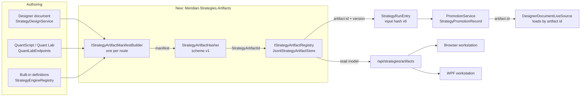

# Blueprint — Versioned Strategy-Artifact Identity Across Authoring Routes

**Status:** draft
**Owner:** Strategy and Research lane
**Reviewed:** 2026-11-17
**Depth mode:** full
**Registered in:** [`docs/engineering/blueprints/README.md`](README.md)
**Related roadmap item:** `W13-STRAT-001` (Governed strategy formulation and execution lifecycle),
first exit criterion: "Existing definitions, Designer documents, QuantScript, and retained run/artifact
records converge on one versioned strategy-artifact identity; parameters, universe, decision rules,
cost assumptions, risk limits, and approval history remain reproducible after edits."
**Companion blueprint:** [Governed Order Command Boundary](governed-order-command-boundary-blueprint.md)
(`W13-OMS-001`). That blueprint's `OrderSubmissionAuthority` carries the `StrategyArtifactId` defined
here.

> This document is a design. It grants no roadmap acceptance and changes no `W13-STRAT-001` status.
> Line references were checked against source on 2026-11-17. Re-check them before implementing.

---

## Current state (source evidence)

Today there is no shared strategy identity. Each route identifies a strategy with a free-form
`string StrategyId` and its own hash, if any.

| Route | Identity today | Content hash today | Gap |
| --- | --- | --- | --- |
| Designer | `StrategyDesignDocument.DocumentId` + client-set `Version` (`Meridian.Contracts/Workstation/StrategyDesignDtos.cs:6`) | `DesignerDocumentRevision.ComputeHash` (`Meridian.Strategies/Live/Designer/DesignerDocumentRevision.cs:51`), carried as the run parameter `designerDocumentHash` | `IStrategyDesignRepository.GetAsync(documentId)` returns only the latest revision, so after any edit the approved revision cannot be loaded and activation fails at `DesignerDocumentLiveSource.TryVerifyRevision` (`:262-289`) |
| QuantScript / Quant Lab | Optional caller-supplied `QuantRunRequest.StrategyId` (`Meridian.Ui.Shared/Endpoints/QuantLabEndpoints.cs:326`) | `RoslynScriptCompiler.ComputeHash` (`:292`), used only as a compile-cache key | Script `Source` and parameter overrides are not in the run's `ParameterSet` or input hash. Two different scripts with the same `StrategyId` get the same identity |
| Built-in / engine definitions | `StrategyEngineDefinition(StrategyId, Version, …)` (`Meridian.Contracts/StrategyEngine/StrategyEngineContracts.cs:141`) | `StrategyEngineValidationService.ComputeInputHash` (`:378`), JSON with no scheme prefix | "Version" is a constant on the class |
| Run records | `StrategyRunEntry.RunId` (GUID) + `StrategyId` (`Meridian.Strategies/Models/StrategyRunEntry.cs:55`) | `InputHashSha256` with schemes `meridian.strategy-run-input.v2`–`v5` plus a legacy scheme (`:630`, `:708`, `:738`, `:748`, `:810`, `:848`) | The hash covers run inputs, not the strategy's own logic |
| Promotion | `StrategyPromotionRecord(…, StrategyId, SourceRunId, …)` (`Meridian.Strategies/Promotions/BacktestToLivePromoter.cs:126`) | none | Approval binds to a run id and strategy id only. `PromotionService.CreatePromotedRun` (`Services/PromotionService.cs:793`) does not copy `ExecutionRealism` or `InputHashSha256`, so the promoted run loses the v4 realism binding |

What exists and should be reused rather than duplicated:

- `Sha256Digest.ComputeUtf8` (`Meridian.Contracts/Integrity/Sha256Digest.cs:57`). Its doc comment requires
  every integrity hash to go through this class.
- The `StrategyRunEntry` encoding conventions: a scheme prefix string, then `AppendCanonical`
  (`len:value|`, `:892`) and `AppendCanonicalCollection` (trim, remove duplicates, sort, `:898`).
- `ExecutionRealismDescriptor.ToCanonicalString()` (`Meridian.Backtesting.Sdk/ExecutionRealismDescriptor.cs:63`).
- Append-only JSONL stores written with `AtomicFileWriter` and a lock file, as in
  `JsonlPromotionRecordStore`.

Avoid the name `ArtifactId` on its own. `OperationArtifactReference.ArtifactId`
(`Meridian.Contracts/Operations/VerifiedOperationOutcome.cs:50`) already means a retained output file.

---

## ⚠️ Breaking Change

**No breaking public-interface changes. All changes are additive.** The three positional records gain
optional trailing parameters, which is source-compatible for every existing call site.

| Surface | Change | Known consumers | Migration |
| --- | --- | --- | --- |
| `StrategyRunEntry` | Add trailing `string? StrategyArtifactId = null` | All run factories (`Start`, `StartWithEvidence`, `StartForFundAccount`) and the six run creators listed under Data Flow | None for compile. Snapshots deserialize the missing field as `null` |
| `StrategyPromotionRecord` | Add trailing `string? StrategyArtifactId = null` | `PromotionService`, `JsonlPromotionRecordStore`, promotion endpoints | None. Existing history rows read as `null` (legacy) |
| `ResearchRunDescriptor` | Add trailing `string? StrategyArtifactId = null` | `StrategyRunResearchRecorder`, Quant Lab and Backtest Studio recorders | None |
| `StrategyRunStore` hash verification (`:894-934`) | Accepts the new `v6` scheme in addition to `v2`–`v5` and legacy | Store write path | None. Old schemes stay accepted for old rows |

**One behavior change (Phase 3, behind an option):** `PromotionService.CreatePromotedRun` starts copying
`ExecutionRealism` and the source artifact id onto the promoted run. Today the promoted run silently drops
the realism binding. This is a correctness fix, but it changes the stored input-hash scheme of newly promoted
runs from v2/v3/v5 to v6. Tests in `PromotionServiceTests` that assert the promoted run's hash scheme must be
updated, not deleted.

---

## Scope

**In scope**

- A content-hashed `StrategyArtifactId` and a per-strategy `StrategyArtifactVersion` ordinal.
- A canonical `StrategyArtifactManifest` that every authoring route can produce: Designer, QuantScript, and
  built-in engine definitions.
- A durable, content-addressed `IStrategyArtifactRegistry`, so any approved revision can be loaded by hash
  after later edits.
- Binding runs and promotions to the artifact id, including a new `meridian.strategy-run-input.v6` scheme.
- Designer activation that loads the approved revision by artifact id instead of "latest".
- A read API so the browser workstation and WPF can show artifact identity and version history from one seam.

**Out of scope** (each is a separate brainstorm idea)

- The side-by-side version diff (Formulation #3). This blueprint only guarantees the data it needs.
- The data-dependency manifest and "will this run?" pre-check (Formulation #2). The manifest reserves a
  `DataDependencies` slot but nothing validates it yet.
- Revocable live authorization (Execution #1). That idea consumes the artifact binding defined here.
- Splitting up `PromotionService.cs`. The changes here are local edits to that file.
- Containment tiers for arbitrary QuantScript code (PRD-012). The artifact records the route; it does not
  grant trust.
- Lean / external-engine runs (`LeanEndpoints.cs:465`). They keep `StrategyArtifactId = null` and are shown
  as "unversioned" until a route builder exists.

**Assumptions to verify before implementing**

1. Universe order does not change strategy behavior. Quant Lab keeps replay order in `symbols`, but that is a
   run parameter. The artifact stores the universe as a sorted set.
2. Built-in strategies (`buy-and-hold`, `moving-average-crossover`) are fully described by their class
   `Version` constant plus parameters.
3. QuantScript runs execute only the cells captured at run time. If a notebook can execute cells that are not
   in the captured source, the source digest must cover the whole notebook.

---

## Architectural Overview

### Context diagram



### Design decisions

- **Decision 1: The id is the hash; the version is a separate ordinal.**
  `StrategyArtifactId` is `sa1-<64 lowercase hex>`, the SHA-256 of the canonical manifest under the scheme
  `meridian.strategy-artifact.v1`. `StrategyArtifactVersion` is an `int` the registry assigns per
  `StrategyKey` the first time it sees a new hash (1, 2, 3, …).
  **Alternatives considered:** a GUID plus version (not reproducible from content); the hash alone (operators
  can't read it); semantic versions chosen by the author (unenforceable, and they drift).
  **Rationale:** Content addressing makes identity reproducible and stops a run from inheriting an approval
  granted to different content. The ordinal gives operators "v3 of momentum-spy". Registering the same
  content twice returns the existing version, so the operation is idempotent.
  **Consequences:** Reverting an edit returns the earlier artifact id and version, which is correct. Version
  numbers are dense per strategy key, not global.

- **Decision 2: Hand-built canonical encoding, following the existing `StrategyRunEntry` conventions. No
  generic JSON canonicalization.**
  **Alternatives considered:** RFC 8785 JSON canonicalization (no helper exists in the repo, and number
  formatting would be a new risk); hashing the source-generated JSON (field order and number formatting are
  not guaranteed stable).
  **Rationale:** The repo already has five run-input schemes built this way and tested in
  `StrategyRunRealismHashTests`. Consistency matters more than elegance here.
  **Consequences:** Every manifest field change needs a new scheme version (`v2`). The scheme prefix makes old
  and new hashes "not comparable", matching the documented run-hash behavior (`StrategyRunEntry.cs:694-699`).

- **Decision 3: The artifact covers what changes trading behavior, and nothing else.**
  Included: `StrategyKey`, authoring route, source digest (decision rules), sorted parameters, sorted universe,
  declared cost assumptions, declared risk limits, and declared data dependencies.
  Excluded: name, description, free-form metadata, timestamps, and the author. This matches
  `DesignerDocumentRevision.ComputeHash`, which already excludes `Name`, `Description`, and `Metadata`.
  **Consequences:** Renaming a strategy does not create a new version. Changing one formula does.

- **Decision 4: Cost assumptions and risk limits on the artifact are *declared* values. The run keeps its own
  effective values.**
  A backtest can run with different slippage than the strategy declares, for example in a sensitivity sweep.
  The run's v6 input hash binds both the artifact id and the run's own `ExecutionRealismDescriptor`. The
  promotion checklist flags a run whose effective realism differs from the artifact's declared realism as
  `OFF_DECLARATION` instead of blocking it.
  **Alternatives considered:** forcing runs to use only declared costs (this would break sweeps); leaving
  costs off the artifact (this would fail the exit criterion).

- **Decision 5: The registry stores the full payload, not just the hash.**
  Each registry row holds the manifest plus the route payload: the `StrategyDesignDocument` snapshot for
  Designer, the captured script source and parameter overrides for QuantScript, or nothing for built-ins.
  **Rationale:** This is what fixes Designer activation after edits, and it makes any approved run
  reproducible. Rows are append-only and validated against the hash on read.
  **Consequences:** Storage grows with each distinct revision. Payloads are small (KBs), and identical content
  is stored once.

- **Decision 6: Legacy runs stay valid and are labeled honestly.**
  Runs and promotions recorded before this change have `StrategyArtifactId = null` and show as
  "unversioned (legacy)". `StrategyArtifactOptions.RequireArtifactForLivePromotion` defaults to `false` in
  Phase 3. Flipping it to `true` is a separate owner decision (Open Question 1).

---

## Interface & API Contracts

### Contract types (`Meridian.Contracts`, namespace `Meridian.Contracts.StrategyEngine`)

File: `src/Meridian.Contracts/StrategyEngine/StrategyArtifactContracts.cs`. These types live in Contracts
because the browser API, WPF, and `Meridian.Strategies` all read them.

```csharp
namespace Meridian.Contracts.StrategyEngine;

/// <summary>Content-addressed identity of one strategy revision. Format: "sa1-" + 64 lowercase hex.</summary>
public readonly record struct StrategyArtifactId
{
    public const string Prefix = "sa1-";
    public string Value { get; }
    private StrategyArtifactId(string value) => Value = value;

    /// <summary>Wraps a digest produced by <see cref="Sha256Digest"/>; throws if it is not canonical.</summary>
    public static StrategyArtifactId FromDigest(string sha256Digest);
    public static bool TryParse(string? value, out StrategyArtifactId id);
    public override string ToString() => Value;
}

/// <summary>Which authoring route produced the artifact. Recorded, never used to grant trust.</summary>
public enum StrategyAuthoringRoute { BuiltIn, Designer, QuantScript }

/// <summary>Everything in a strategy revision that changes what it trades. Input to the hash.</summary>
public sealed record StrategyArtifactManifest(
    string StrategyKey,                                    // the existing StrategyId, trimmed
    StrategyAuthoringRoute Route,
    string SourceDigest,                                   // Designer revision hash / script digest / built-in version
    IReadOnlyDictionary<string, string> Parameters,        // sorted ordinal on hash
    IReadOnlyList<string> Universe,                        // sorted, de-duplicated on hash
    string? DeclaredRealism,                               // ExecutionRealismDescriptor.ToCanonicalString(), or null
    IReadOnlyDictionary<string, string> DeclaredRiskLimits,
    IReadOnlyList<StrategyDataDependency> DataDependencies); // reserved for Formulation #2; may be empty

public sealed record StrategyDataDependency(string Symbol, string Resolution, string? Provider, int? LookbackBars);

/// <summary>One registered revision as returned by the registry and the read API.</summary>
public sealed record StrategyArtifactRecord(
    StrategyArtifactId ArtifactId,
    string StrategyKey,
    int Version,
    StrategyArtifactManifest Manifest,
    string HashScheme,                 // "meridian.strategy-artifact.v1"
    DateTimeOffset FirstRegisteredAt,
    string? FirstRegisteredBy);

/// <summary>Read-model summary for list views.</summary>
public sealed record StrategyArtifactSummary(
    string ArtifactId, string StrategyKey, int Version, StrategyAuthoringRoute Route,
    DateTimeOffset FirstRegisteredAt, int RunCount, bool HasLivePromotion);
```

### Hasher (`Meridian.Strategies`, namespace `Meridian.Strategies.Artifacts`)

```csharp
/// <summary>Canonical encoding and hashing of a manifest. Pure and deterministic.</summary>
public static class StrategyArtifactHasher
{
    public const string SchemeV1 = "meridian.strategy-artifact.v1";

    /// <summary>
    /// Encodes the scheme prefix, then each field with the StrategyRunEntry len:value| convention.
    /// Parameters and risk limits are sorted by ordinal key; universe is trimmed, upper-cased,
    /// de-duplicated and sorted; data dependencies are sorted by (Symbol, Resolution).
    /// </summary>
    public static StrategyArtifactId Compute(StrategyArtifactManifest manifest);

    /// <summary>Exposed for golden-vector tests and diagnostics.</summary>
    public static string BuildCanonicalString(StrategyArtifactManifest manifest);
}
```

Move `AppendCanonical` / `AppendCanonicalCollection` out of `StrategyRunEntry` into an internal
`StrategyCanonicalEncoding` helper in the same assembly, and call it from both places. This is a pure move
with no encoding change. The existing `StrategyRunRealismHashTests` golden values prove it.

### Route builders (`Meridian.Strategies.Artifacts`)

```csharp
/// <summary>Builds a manifest plus the payload the registry must retain for one route.</summary>
public interface IStrategyArtifactManifestBuilder<in TSource>
{
    StrategyAuthoringRoute Route { get; }
    StrategyArtifactDraft Build(TSource source);
}

/// <summary>A manifest and its route payload, before registration.</summary>
public sealed record StrategyArtifactDraft(StrategyArtifactManifest Manifest, StrategyArtifactPayload Payload);

/// <summary>Route payload retained for reproduction. Exactly one member is set, or none for built-ins.</summary>
public sealed record StrategyArtifactPayload(
    StrategyDesignDocument? DesignerDocument,
    QuantScriptArtifactSource? QuantScript);

public sealed record QuantScriptArtifactSource(string Source, IReadOnlyDictionary<string, string> ParameterOverrides);
```

| Builder | `TSource` | `SourceDigest` | Notes |
| --- | --- | --- | --- |
| `DesignerArtifactManifestBuilder` | `StrategyDesignDocument` | `DesignerDocumentRevision.ComputeHash(document)` (unchanged) | Risk limits come from risk-purpose cells (`DesignerStrategyPlan.cs:407`). Parameters come from sorted cell parameters |
| `QuantScriptArtifactManifestBuilder` | `QuantScriptArtifactSource` | `Sha256Digest.ComputeUtf8("meridian.quantscript-source.v1\u001f" + normalized source)`. Normalization: `\r\n` → `\n`, trailing whitespace trimmed per line | Parameter overrides go into `Parameters`, not the digest |
| `BuiltInArtifactManifestBuilder` | `(StrategyEngineDefinition, IReadOnlyDictionary<string,string> parameters)` | `"builtin:" + definition.StrategyId + "@" + definition.Version` | Risk limits come from `StrategyEngineRunRequest.RiskConstraints` |

### Registry

```csharp
namespace Meridian.Strategies.Interfaces;

/// <summary>Durable, content-addressed store of strategy revisions. Append-only.</summary>
public interface IStrategyArtifactRegistry
{
    /// <summary>
    /// Idempotent. Returns the existing record when the hash is already registered; otherwise
    /// assigns the next version for the strategy key and appends a row.
    /// </summary>
    Task<StrategyArtifactRecord> RegisterAsync(StrategyArtifactDraft draft, string? actor, CancellationToken ct = default);

    Task<StrategyArtifactRecord?> GetAsync(StrategyArtifactId id, CancellationToken ct = default);
    Task<StrategyArtifactPayload?> GetPayloadAsync(StrategyArtifactId id, CancellationToken ct = default);
    Task<IReadOnlyList<StrategyArtifactRecord>> GetVersionsAsync(string strategyKey, CancellationToken ct = default);
    Task<StrategyArtifactRecord?> ResolveAsync(string strategyKey, int version, CancellationToken ct = default);
}
```

### Modified records (additive)

```csharp
// StrategyRunEntry.cs — new trailing parameter and a v6 hash scheme
public sealed record StrategyRunEntry(
    /* …existing parameters unchanged… */
    Guid? FundAccountId = null,
    string? StrategyArtifactId = null);

/// <summary>v6: v5 fields + realism + artifact id. Used only when StrategyArtifactId is set.</summary>
public static string ComputeArtifactBoundInputHash(StrategyRunEntry entry);  // prefix "meridian.strategy-run-input.v6"

// BacktestToLivePromoter.cs
public sealed record StrategyPromotionRecord(/* …existing… */ string? ManualOverrideId = null,
    string? StrategyArtifactId = null);

// IResearchRunRecorder.cs
public sealed record ResearchRunDescriptor(/* …existing… */ string? StrategyArtifactId = null);
```

Add `StrategyArtifactRecord`, `StrategyArtifactManifest`, `StrategyArtifactPayload`, and
`StrategyArtifactSummary` to a new `StrategyArtifactJsonContext`
(`src/Meridian.Strategies/Serialization/`), following `PromotionRecordJsonContext` (ADR-014).
`StrategyRunPersistenceJsonContext` and `PromotionRecordJsonContext` need no new types; the new fields are
`string?`.

### Configuration

```csharp
public sealed class StrategyArtifactOptions
{
    public const string SectionName = "StrategyArtifacts";
    /// <summary>When true, live promotion refuses a source run with no artifact id. Phase 3 default: false.</summary>
    public bool RequireArtifactForLivePromotion { get; init; }
    /// <summary>Relative to the data root. Default matches the other strategy stores.</summary>
    public string StorePath { get; init; } = "strategies/artifacts/strategy-artifacts.jsonl";
}
```

```json
{ "StrategyArtifacts": { "RequireArtifactForLivePromotion": false } }
```

### REST surface (shared by browser and WPF)

```
GET /api/strategies/{strategyKey}/artifacts
  200: StrategyArtifactSummary[]                (newest version first)

GET /api/strategies/artifacts/{artifactId}
  200: StrategyArtifactRecord
  400: { "error": "Malformed strategy artifact id." }
  404: { "error": "Strategy artifact not found." }
```

Both routes require `UserPermission.ViewStrategies`. There are no write endpoints. Registration happens only
as a side effect of a run or a Designer save, on the server. Add route constants to `UiApiRoutes` and generated
TypeScript types through the existing contract generation.

---

## Component Design

### StrategyArtifactRegistry

**Namespace:** `Meridian.Strategies.Artifacts`
**Type:** `sealed class StrategyArtifactRegistry : IStrategyArtifactRegistry`
**Lifetime:** Singleton
**Storage:** `JsonlStrategyArtifactStore` (`Meridian.Strategies/Storage/`), modeled on
`JsonlPromotionRecordStore`. It writes `<dataRoot>/strategies/artifacts/strategy-artifacts.jsonl` with
`AtomicFileWriter.AppendLinesAsync` and a lock file (ADR-007). Never use `File.WriteAllText`.

**Responsibilities:**
- Compute the hash with `StrategyArtifactHasher` and refuse a draft whose manifest is malformed (empty key,
  missing source digest).
- Look up by hash. If found, return the existing record. If not found, assign `max(version for key) + 1` and
  append.
- On load, recompute every row's hash and refuse to start if one does not match (fail closed, same as
  `StrategyRunStore`).
- Keep an in-memory index `Dictionary<StrategyArtifactId, StrategyArtifactRecord>` plus per-key version lists,
  built at first use.

**Dependencies:** `IOptions<StrategyArtifactOptions>`, the data-root provider used by the other strategy stores,
`TimeProvider`, `ILogger<StrategyArtifactRegistry>`.

**Concurrency:** One `SemaphoreSlim(1,1)` serializes `RegisterAsync` across hash lookup, version assignment, and
append, so two concurrent registrations of new content cannot both take the same version. Reads use the index
without the lock. The file lock covers cross-process writers, the same as the promotion store.

**Error handling:** A hash mismatch on load throws `StrategyArtifactIntegrityException` and logs the line
number with structured logging. A failed append leaves the index unchanged, because the index is updated only
after the append returns.

### Route integration points

| Run creator | Change |
| --- | --- |
| `WorkstationEndpoints.Strategy.cs:290-325` (Designer run) | Build the draft with `DesignerArtifactManifestBuilder`, register it, and pass the artifact id to `StartWithEvidence`. Keep `designerDocumentHash` in `ParameterSet` for compatibility |
| `StrategyDesignService` save path | Register on save, so every saved revision is retrievable even if never run |
| `QuantLabEndpoints.cs:203` | When `StrategyId` is supplied, build from `QuantRunRequest.Source` + `Parameters`, register, and set it on each `ResearchRunDescriptor` |
| `BacktestStudioRunOrchestrator.cs:61` | Built-in or Designer builder, depending on `Engine` |
| `StrategyRunResearchRecorder.cs:58` | Pass `descriptor.StrategyArtifactId` into the entry; use v6 when set |
| `StrategyLifecycleManager.cs:363`, `CoveredCallRunProjection.cs:30`, `Wpf/Services/StrategyRunWorkspaceService.cs:348` | Pass through an artifact id when the caller has one; otherwise `null` (legacy) |
| `LeanEndpoints.cs:465` | No change. Stays unversioned (out of scope) |

### PromotionService changes

- `EvaluatePromotion`: the result gains `StrategyArtifactId` and `StrategyArtifactVersion`. If the option
  requires an artifact and the source run has none, add the blocker `STRATEGY_ARTIFACT_MISSING`.
- `CreatePromotedRun` (`:793`): copy `StrategyArtifactId` and `ExecutionRealism` from the source run. The
  store then computes v6, and the realism binding is no longer lost.
- `RecordPromotionAuditAsync`: extend the audit scope string (`:910`) to
  `source:{runId}/strategy:{strategyId}/artifact:{artifactId|none}/target:{type}`.
- Before approving a live promotion, verify that `registry.GetAsync(artifactId)` returns a record whose
  manifest hash recomputes to the same id.

### DesignerDocumentLiveSource changes

- Resolve the document from `registry.GetPayloadAsync(run.StrategyArtifactId)` when the run carries an artifact
  id, instead of `IStrategyDesignRepository.GetAsync(documentId)` (latest).
- Keep `TryVerifyRevision` as defense in depth: recompute `DesignerDocumentRevision.ComputeHash` on the loaded
  payload and compare it to `designerDocumentHash`.
- Legacy runs with no artifact id keep today's latest-revision behavior.

---

## Data Flow

### Designer run → promotion → live activation (happy path)

1. The operator saves a Designer document. `StrategyDesignService` saves the draft, then calls
   `RegisterAsync`, which returns `sa1-…` version 3.
2. The operator runs a backtest. The endpoint builds the draft again, and `RegisterAsync` returns the same
   record (idempotent). It creates `StrategyRunEntry` with `StrategyArtifactId = sa1-…`.
3. `StrategyRunStore.RecordRunAsync` verifies the v6 hash and appends the snapshot.
4. The operator promotes to paper, then live. `CreatePromotedRun` copies the artifact id and realism. The
   `StrategyPromotionRecord` stores the artifact id, and the audit scope names it.
5. The operator edits the document, which registers version 4.
6. Live activation of the promoted run loads version 3's payload by artifact id. `TryVerifyRevision` passes.
   The strategy trades exactly the approved revision.

### QuantScript run (new binding)

1. A `POST` to `UiApiRoutes.QuantRun` arrives with `StrategyId = "momentum-spy"` and the source.
2. `QuantScriptArtifactManifestBuilder` digests the normalized source and sorts the overrides.
   `RegisterAsync` returns version N.
3. Each captured backtest's descriptor carries the artifact id, so every run now binds to its exact code.

### Error paths

- **Registry file corrupted:** the load-time hash check fails. Registration endpoints return a 503
  "pre-dispatch unavailable"-style refusal, and runs are not recorded with a fabricated id. The operator sees an
  explicit blocked state.
- **Activation finds no payload for the artifact id:** activation is refused with
  `STRATEGY_ARTIFACT_PAYLOAD_MISSING`. It never falls back to the latest document for a run that has an
  artifact id.
- **Same hash under two strategy keys:** impossible by construction, because `StrategyKey` is part of the hash.

---

## UI Design

The design is shared across browser and WPF, consuming one seam (`GET /api/strategies/...artifacts`).

- **Run detail / run history (browser `trading-strategy` run views, WPF `StrategyRunWorkspace`):** add an
  "Artifact" field showing `momentum-spy · v3`. Hovering it shows the full `sa1-…` id and the route. Legacy runs
  show "Unversioned (legacy)" in muted text, never a blank.
- **Promotion review panel:** show the artifact version being approved and an `OFF_DECLARATION` warning chip
  when the run's realism differs from the declared realism.
- **WPF:** add `StrategyArtifactId`/`ArtifactVersionLabel` properties on the existing run-detail view model,
  which inherits `BindableBase`. No new page. The parity checklist row goes in
  `docs/engineering/plans/wpf-web-ui-alignment-plan.md`.

---

## Test Plan

**Principle:** The hash is a durable contract. Golden vectors pin it, and every route is tested for
"same content gives the same id" and "any behavior-changing edit gives a new id".

### Unit tests — `StrategyArtifactHasherTests` (`tests/Meridian.Tests/Strategies/`)

| Test | Verifies |
| --- | --- |
| `Compute_GoldenManifest_MatchesPinnedDigest` | Encoding is stable. The pinned hex value is committed |
| `Compute_ParameterOrderDiffers_SameId` | Parameters are sorted before hashing |
| `Compute_UniverseCaseAndDuplicates_SameId` | Universe normalization |
| `Compute_ParameterValueChanged_NewId` | Behavior-changing edit |
| `Compute_DeclaredRiskLimitChanged_NewId` | Risk limits are covered |
| `Compute_DeclaredRealismChanged_NewId` | Cost assumptions are covered |
| `Compute_SameContentDifferentStrategyKey_DifferentId` | Key is in the hash |
| `FromDigest_NonCanonicalHex_Throws` / `TryParse_MissingPrefix_ReturnsFalse` | Id format |

### Unit tests — route builders

| Test | Verifies |
| --- | --- |
| `Designer_NameAndDescriptionChanged_SameId` | Matches the `DesignerDocumentRevision` exclusions |
| `Designer_CellFormulaChanged_NewId` | Decision-rule coverage |
| `QuantScript_LineEndingsDiffer_SameId` | Source normalization |
| `QuantScript_SourceChanged_NewId` | Closes the "two scripts, one identity" gap |
| `BuiltIn_VersionConstantChanged_NewId` | Built-in route |

### Unit tests — `StrategyArtifactRegistryTests`

| Test | Verifies |
| --- | --- |
| `RegisterAsync_SameDraftTwice_ReturnsSameVersion` | Idempotency |
| `RegisterAsync_NewContent_AssignsNextVersion` | Ordinal assignment |
| `RegisterAsync_RevertToEarlierContent_ReturnsEarlierVersion` | Content addressing |
| `RegisterAsync_ConcurrentNewContent_DistinctVersions` | Lock correctness (20 parallel tasks) |
| `Load_TamperedRow_ThrowsIntegrityException` | Fail-closed load |
| `GetPayloadAsync_AfterRestart_ReturnsDesignerSnapshot` | Durability via `AtomicFileWriter` |

### Unit tests — existing suites to extend

| Suite | New test |
| --- | --- |
| `StrategyRunRealismHashTests` | `V6_IncludesArtifactId`; existing v2–v5 golden values unchanged after the encoding-helper move |
| `StrategyRunStoreTests` | `RecordRunAsync_V6HashMismatch_Rejected`; `RecordRunAsync_LegacyRunWithoutArtifact_Accepted` |
| `PromotionServiceTests` | `CreatePromotedRun_CopiesArtifactIdAndRealism`; `Evaluate_RequireArtifactOption_BlocksLegacyRun` |
| `DesignerDocumentLiveSourceTests` | `Activate_DocumentEditedAfterPromotion_LoadsApprovedRevisionByArtifactId` (today this scenario fails activation) |
| `QuantLabParameterSetTests` | `Run_WithStrategyId_DescriptorCarriesArtifactId` |

### Integration test

| Test | Verifies |
| --- | --- |
| `DesignerEditAfterPromotion_ScenarioTests` (in `tests/Meridian.Tests/Ui/`) | Save → run → promote paper → edit → activate. The promoted run trades the approved revision, and the run history shows v3 for the run and v4 as the latest |

### Browser

- A `vitest` test for the run-detail artifact label, covering both the versioned and the legacy rendering.

---

## Implementation Checklist

**Estimated effort:** High (about 8–10 focused days)
**Suggested branch:** `claude/strategy-artifact-identity`
**Suggested PR sequence:** PR1 = Phases 1–2 (no behavior change); PR2 = Phase 3; PR3 = Phases 4–5.

### Phase 1: Foundation (no behavior change)
- [ ] Move `AppendCanonical` / `AppendCanonicalCollection` into `StrategyCanonicalEncoding`; existing golden hashes stay green
- [ ] Add the contract types in `StrategyArtifactContracts.cs`
- [ ] Add `StrategyArtifactHasher` with pinned golden-vector tests
- [ ] Add the three route builders with their tests

### Phase 2: Registry
- [ ] Add `IStrategyArtifactRegistry`, `StrategyArtifactRegistry`, `JsonlStrategyArtifactStore`, `StrategyArtifactJsonContext`
- [ ] Register in `WorkstationServiceCollectionExtensions` (singleton) and bind `StrategyArtifactOptions`
- [ ] Registry tests, including the concurrency and tamper cases

### Phase 3: Bind runs and promotions
- [ ] Add the trailing `StrategyArtifactId` to `StrategyRunEntry`, `StrategyPromotionRecord`, `ResearchRunDescriptor`
- [ ] Add the v6 scheme; extend `StrategyRunStore` verification (`:894-934`)
- [ ] Wire the Designer, Quant Lab, and Backtest Studio run creators
- [ ] `PromotionService`: copy artifact id and realism on promotion, extend the audit scope, add the evaluation blocker behind the option
- [ ] Update `PromotionServiceTests` assertions on the promoted-run hash scheme

### Phase 4: Activation by artifact
- [ ] `DesignerDocumentLiveSource` loads the payload by artifact id; refuses when it is missing
- [ ] Register on Designer save
- [ ] Integration scenario test

### Phase 5: Read surfaces
- [ ] REST routes, `UiApiRoutes` constants, generated TypeScript types
- [ ] Browser run-detail and promotion-panel labels, plus a vitest test
- [ ] WPF run-detail properties and a parity-plan row

### Phase 6: Wrap-up
- [ ] Docs: `docs/architecture/strategy-engine-foundation.md` (identity section), the Strategies README, and register this blueprint in `docs/engineering/blueprints/README.md`
- [ ] Targeted validation: `dotnet test tests/Meridian.Tests --filter "FullyQualifiedName~Strategies"`, the Quant Lab UI tests, and `npm --prefix src/Meridian.Ui/dashboard run test`
- [ ] XML doc comments on every public type; structured logging only

---

## Open Questions

| # | Question | Owner | Impact if unresolved |
| --- | --- | --- | --- |
| 1 | When should `RequireArtifactForLivePromotion` become `true`, and what happens to already-promoted live runs with no artifact id (grandfather them, or require re-promotion)? | Product owner | Legacy live runs keep promoting on run-id identity alone |
| 2 | Should a QuantScript run with no `StrategyId` get an artifact under a derived key (for example `quantscript:<digest[..12]>`) so it is recorded at all? | Product owner | Unnamed Quant Lab runs stay unrecorded, as they are today |
| 3 | Do notebooks execute cells that are not in the captured `Source`? (Assumption 3) | Implementer | The digest may under-cover the executed code |
| 4 | Should the built-in `SourceDigest` include an assembly build hash, so a code change without a `Version` bump still produces a new id? | Implementer | A silent logic change in a built-in keeps the same id |

## Risks

| Risk | Likelihood | Impact | Mitigation |
| --- | --- | --- | --- |
| Encoding-helper move changes an existing run hash | Low | High (stored runs fail verification) | Pure move; v2–v5 golden tests must pass unchanged before anything else lands |
| Designer `Version` is client-set and part of the hash, so a client can bump it to force a new artifact | Medium | Low | Harmless: new content-free versions are visible in history. Optionally drop `Version` from the Designer digest in scheme v2 |
| Registry and run store drift (run references an artifact that is not in the registry) | Low | Medium | Register before recording the run. `RecordRunAsync` refuses an artifact id the registry doesn't know |
| Payload growth for very large Designer documents | Low | Low | Content stored once per distinct hash; monitor file size in the storage health check |
