<!-- Generated by build/scripts/schema-control.py. Do not edit directly. -->

# `fund-governance-contracts` data objects - page 3 of 3

Objects 161-174 of 174. References crossing pages remain available in the dependency manifest.

```mermaid
classDiagram
    %% fund-governance-contracts: module mapping, not DTO/table equivalence
    class Meridian_Contracts_FundStructure_RecordAccountSyncHistoryRequest["RecordAccountSyncHistoryRequest"] {
        +Guid AccountId
        +DateTimeOffset? AttemptedAt
        +string Capability
        +DateTimeOffset? CompletedAt
        +string? CorrelationId
        +string? ExternalAccountId
        +AccountSyncFailureKindDto FailureKind
        +string? FailureMessage
        +DateTimeOffset? FreshUntil
        +string? ProjectionEvidencePath
        +string? ProviderId
        +AccountProviderLinkStatusDto ProviderLinkStatus
    }
    class Meridian_Contracts_FundStructure_RecordMarginSnapshotRequest["RecordMarginSnapshotRequest"] {
        +Guid AccountId
        +string? AgreementEvidencePath
        +bool ApprovedForLiveMargin
        +decimal? BuyingPower
        +decimal? CollateralValue
        +int ConcentrationLimitBreachCount
        +string? CorrelationId
        +decimal? CreditBalance
        +string Currency
        +decimal? DebitBalance
        +DateTimeOffset EffectiveAt
        +decimal? ExcessLiquidity
    }
    class Meridian_Contracts_FundStructure_ReplaceOwnershipLinkRequest["ReplaceOwnershipLinkRequest"] {
        +Guid ChildNodeId
        +DateTimeOffset EffectiveFrom
        +bool IsPrimary
        +string? Notes
        +Guid OwnershipLinkId
        +decimal? OwnershipPercent
        +Guid ParentNodeId
        +OwnershipRelationshipTypeDto RelationshipType
        +string ReplacedBy
        +DateTimeOffset? ReplacedEffectiveTo
        +Guid ReplacementOwnershipLinkId
    }
    class Meridian_Contracts_FundStructure_SecurityMasterAccessSummaryDto["SecurityMasterAccessSummaryDto"] {
        +string AvailabilityDescription
        +bool EconomicDefinitionsAccessible
        +bool InstrumentDefinitionsAccessible
        +bool IsAvailable
        +bool TradingParametersAccessible
    }
    class Meridian_Contracts_FundStructure_SleeveSummaryDto["SleeveSummaryDto"] {
        +IReadOnlyList~Guid~ AccountIds
        +string Code
        +DateTimeOffset EffectiveFrom
        +DateTimeOffset? EffectiveTo
        +Guid FundId
        +IReadOnlyList~Guid~ InvestmentPortfolioIds
        +bool IsActive
        +string? Mandate
        +string Name
        +Guid SleeveId
        +IReadOnlyList~Guid~ StrategyIds
    }
    class Meridian_Contracts_FundStructure_TransferMatchDto["TransferMatchDto"] {
        +decimal? AmountVariance
        +string? EvidencePath
        +DateTimeOffset MatchedAt
        +Guid? MatchedTransferId
        +int? SettlementDateDeltaDays
        +Guid SourceTransferId
        +TransferMatchStatusDto Status
        +Guid TransferMatchId
    }
    class Meridian_Contracts_FundStructure_TransferMatchStatusDto["TransferMatchStatusDto"] {
    }
    class Meridian_Contracts_FundStructure_UpdateBankAccountDetailsRequest["UpdateBankAccountDetailsRequest"] {
        +BankAccountDetailsDto Details
        +string UpdatedBy
    }
    class Meridian_Contracts_FundStructure_UpdateCustodianAccountDetailsRequest["UpdateCustodianAccountDetailsRequest"] {
        +CustodianAccountDetailsDto Details
        +string UpdatedBy
    }
    class Meridian_Contracts_FundStructure_UpdateLegalEntityProfileRequest["UpdateLegalEntityProfileRequest"] {
        +string? BaseCurrency
        +IReadOnlyList~BeneficialOwnerSummaryDto~? BeneficialOwners
        +string? Code
        +string? Description
        +DateTimeOffset? EffectiveFrom
        +DateTimeOffset? EffectiveTo
        +Guid EntityId
        +LegalEntityTypeDto? EntityType
        +bool? IsActive
        +string? Jurisdiction
        +LegalEntityFormDto? LegalForm
        +LegalEntityLifecycleEventDto? LifecycleEvent
    }
    class Meridian_Contracts_FundStructure_UpdateOwnershipLinkRequest["UpdateOwnershipLinkRequest"] {
        +DateTimeOffset EffectiveFrom
        +DateTimeOffset? EffectiveTo
        +bool IsPrimary
        +string? Notes
        +Guid OwnershipLinkId
        +decimal? OwnershipPercent
        +OwnershipRelationshipTypeDto RelationshipType
        +string UpdatedBy
    }
    class Meridian_Contracts_FundStructure_ValidateOwnershipGraphRequest["ValidateOwnershipGraphRequest"] {
        +bool ActiveOnly
        +DateTimeOffset? AsOf
    }
    class Meridian_Contracts_FundStructure_VehicleOperatingViewDto["VehicleOperatingViewDto"] {
        +IReadOnlyList~AccountSummaryDto~ Accounts
        +IReadOnlyList~InvestmentPortfolioSummaryDto~ InvestmentPortfolios
        +LegalEntitySummaryDto? LegalEntity
        +VehicleSummaryDto Vehicle
    }
    class Meridian_Contracts_FundStructure_VehicleSummaryDto["VehicleSummaryDto"] {
        +IReadOnlyList~Guid~ AccountIds
        +string BaseCurrency
        +string Code
        +string? Description
        +DateTimeOffset EffectiveFrom
        +DateTimeOffset? EffectiveTo
        +Guid FundId
        +IReadOnlyList~Guid~ InvestmentPortfolioIds
        +bool IsActive
        +Guid LegalEntityId
        +string Name
        +Guid VehicleId
    }
    Meridian_Contracts_FundStructure_TransferMatchDto --> Meridian_Contracts_FundStructure_TransferMatchStatusDto
    Meridian_Contracts_FundStructure_VehicleOperatingViewDto --> Meridian_Contracts_FundStructure_VehicleSummaryDto
```

