<!-- Generated by build/scripts/schema-control.py. Do not edit directly. -->

# `ledger-contracts` data objects - page 5 of 5

Objects 321-344 of 344. References crossing pages remain available in the dependency manifest.

```mermaid
classDiagram
    %% ledger-contracts: module mapping, not DTO/table equivalence
    class Meridian_Contracts_Ledger_RealizedGainLossReportDto["RealizedGainLossReportDto"] {
        +AccountingCertificationStateDto CertificationState
        +string Currency
        +LedgerDimensionSetDto Dimensions
        +IReadOnlyList~string~ EvidenceLinks
        +string FundProfileId
        +Guid? LedgerBookId
        +string PeriodId
        +decimal RealizedGainLoss
        +string ReportId
    }
    class Meridian_Contracts_Ledger_ReopenClosePeriodRequestDto["ReopenClosePeriodRequestDto"] {
        +OperationsActionOriginDto ActionOrigin
        +string Actor
        +string ApprovalReference
        +string? CorrelationId
        +IReadOnlyList~string~ EvidenceLinks
        +long ExpectedWorkflowVersion
        +string ImpactSummary
        +string IncidentId
        +string Justification
        +string Rationale
        +string Role
        +Guid WorkflowId
    }
    class Meridian_Contracts_Ledger_ReopenLedgerPeriodRequest["ReopenLedgerPeriodRequest"] {
        +OperationsActionOriginDto ActionOrigin
        +string ApprovalReference
        +IReadOnlyList~string~ EvidenceLinks
        +string Reason
        +string ReopenedBy
        +string Role
    }
    class Meridian_Contracts_Ledger_ReportCertificationDto["ReportCertificationDto"] {
        +string Actor
        +string CertificationId
        +IReadOnlyList~string~ EvidenceLinks
        +DateTimeOffset RecordedAtUtc
        +AccountingCertificationStateDto State
        +string Summary
    }
    class Meridian_Contracts_Ledger_ReportDimensionScopeDto["ReportDimensionScopeDto"] {
        +string CertificationEvidenceToken
        +LedgerDimensionSetDto Dimensions
        +bool HasExplicitScope
        +Guid? LedgerBookId
        +IReadOnlyList~string~ ScopedDimensionKeys
        +string ScopeHash
    }
    class Meridian_Contracts_Ledger_ReportExportArtifactDto["ReportExportArtifactDto"] {
        +string ArtifactId
        +string ArtifactKind
        +AccountingCertificationStateDto CertificationState
        +string ContentHash
        +LedgerDimensionSetDto Dimensions
        +ReportDimensionScopeDto? DimensionScope
        +string DisplayName
        +IReadOnlyList~string~ EvidenceLinks
        +string Format
        +DateTimeOffset GeneratedAtUtc
        +Guid? LedgerBookId
        +string Route
    }
    class Meridian_Contracts_Ledger_ReportExportArtifactManifestDto["ReportExportArtifactManifestDto"] {
        +string ArtifactId
        +string ArtifactKind
        +AccountingCertificationStateDto CertificationState
        +string ContentHash
        +string ContentType
        +LedgerDimensionSetDto Dimensions
        +ReportDimensionScopeDto? DimensionScope
        +string DisplayName
        +IReadOnlyList~string~ EvidenceLinks
        +bool ExternalPostingAllowed
        +string FileName
        +string Format
    }
    class Meridian_Contracts_Ledger_ReportLineProvenanceDto["ReportLineProvenanceDto"] {
        +decimal Amount
        +string Currency
        +LedgerDimensionSetDto Dimensions
        +IReadOnlyList~string~ EvidenceLinks
        +string LineId
        +string LineLabel
        +string SourceKind
        +string StatementId
    }
    class Meridian_Contracts_Ledger_RestatementWorkflowDto["RestatementWorkflowDto"] {
        +ManualJournalEntryStatusDto ApprovalState
        +IReadOnlyList~string~ EvidenceLinks
        +string PriorPackageId
        +string ReasonCode
        +DateTimeOffset RequestedAtUtc
        +string RequestedBy
        +string RestatementId
    }
    class Meridian_Contracts_Ledger_ReviewCloseEvidenceRequestDto["ReviewCloseEvidenceRequestDto"] {
        +OperationsActionOriginDto ActionOrigin
        +string Actor
        +string? CorrelationId
        +IReadOnlyList~string~ EvidenceLinks
        +string IssueCode
        +string Notes
        +string? TargetId
        +Guid WorkflowId
    }
    class Meridian_Contracts_Ledger_ReviewLateAdjustmentRequestDto["ReviewLateAdjustmentRequestDto"] {
        +OperationsActionOriginDto ActionOrigin
        +string Actor
        +string? CorrelationId
        +ManualJournalEntryStatusDto Decision
        +IReadOnlyList~string~ EvidenceLinks
        +string Notes
        +string RequestId
        +Guid WorkflowId
    }
    class Meridian_Contracts_Ledger_RuleDryRunRequestDto["RuleDryRunRequestDto"] {
        +string Actor
        +string? CompanyId
        +string? CorrelationId
        +string? CounterpartyId
        +string Currency
        +LedgerDimensionSetDto? Dimensions
        +DateOnly EffectiveDate
        +decimal EventAmount
        +string FundProfileId
        +string? InstrumentSymbol
        +Guid? LedgerBookId
        +IReadOnlyDictionary~string__decimal~? LotMutationComponents
    }
    class Meridian_Contracts_Ledger_RuleDryRunResultDto["RuleDryRunResultDto"] {
        +string Currency
        +DateOnly EffectiveDate
        +decimal EventAmount
        +string FundProfileId
        +IReadOnlyList~AccountingJournalPreviewLineDto~ GeneratedLines
        +IReadOnlyList~GeneratedPostingLineDto~ GeneratedPostingLines
        +bool IsPostingBalanced
        +Guid? LedgerBookId
        +IReadOnlyList~AccountingRuleDryRunMatchDto~ RuleMatches
        +string? SelectedRuleId
        +string SourceEventType
        +IReadOnlyList~AccountingConfigurationValidationIssueDto~ ValidationIssues
    }
    class Meridian_Contracts_Ledger_RulePromotionApprovalDto["RulePromotionApprovalDto"] {
        +string ApprovalId
        +ManualJournalEntryStatusDto ApprovalState
        +DateTimeOffset? ApprovedAtUtc
        +string? ApprovedBy
        +IReadOnlyList~string~ EvidenceLinks
        +string? Notes
        +DateTimeOffset RequestedAtUtc
        +string RequestedBy
    }
    class Meridian_Contracts_Ledger_SaveManualJournalEntryDraftRequest["SaveManualJournalEntryDraftRequest"] {
        +string Actor
        +string? CompanyId
        +string? CorrelationId
        +ManualJournalEntryDraftDto Draft
        +IReadOnlyList~string~? EvidenceLinks
        +Guid? LedgerBookId
        +bool PeriodIsLocked
        +IReadOnlyList~string~? ReportGroupPrincipalIds
        +string? TenantId
    }
    class Meridian_Contracts_Ledger_SignOffCloseTaskRequestDto["SignOffCloseTaskRequestDto"] {
        +OperationsActionOriginDto ActionOrigin
        +string Actor
        +string? CorrelationId
        +ManualJournalEntryStatusDto Decision
        +IReadOnlyList~string~ EvidenceLinks
        +string Notes
        +string Role
        +string TaskId
        +Guid WorkflowId
    }
    class Meridian_Contracts_Ledger_SubmitManualJournalEntryApprovalRequest["SubmitManualJournalEntryApprovalRequest"] {
        +OperationsActionOriginDto ActionOrigin
        +string Actor
        +string? CompanyId
        +string? CorrelationId
        +IReadOnlyList~string~? EvidenceLinks
        +string FundProfileId
        +Guid JournalEntryId
        +Guid? LedgerBookId
        +string? Notes
        +bool PeriodIsLocked
        +IReadOnlyList~string~? ReportGroupPrincipalIds
        +string? TenantId
    }
    class Meridian_Contracts_Ledger_TreasuryLedgerContextDto["TreasuryLedgerContextDto"] {
        +string? BatchCorrelationId
        +string? CapitalAccountId
        +DateOnly? EffectiveDate
        +string? FundEventId
        +string? FundEventType
        +string? IdempotencyKey
        +string? InvestorId
        +string? PaymentIntentId
        +string? SettlementReference
    }
    class Meridian_Contracts_Ledger_UpsertAccountingRuleTestCaseRequest["UpsertAccountingRuleTestCaseRequest"] {
        +string Actor
        +string? CompanyId
        +string? CorrelationId
        +IReadOnlyList~string~? EvidenceLinks
        +string FundProfileId
        +Guid? LedgerBookId
        +IReadOnlyList~string~? ReportGroupPrincipalIds
        +string? TenantId
        +AccountingRuleTestCaseDto TestCase
    }
    class Meridian_Contracts_Ledger_UpsertChartOfAccountsNodeRequest["UpsertChartOfAccountsNodeRequest"] {
        +string Actor
        +string? CompanyId
        +string? CorrelationId
        +IReadOnlyList~string~? EvidenceLinks
        +string FundProfileId
        +Guid? LedgerBookId
        +ChartOfAccountsNodeDto Node
        +IReadOnlyList~string~? ReportGroupPrincipalIds
        +string? TenantId
    }
    class Meridian_Contracts_Ledger_UpsertClosePeriodPlanConfigurationRequestDto["UpsertClosePeriodPlanConfigurationRequestDto"] {
        +OperationsActionOriginDto ActionOrigin
        +string? Actor
        +string? CorrelationId
        +IReadOnlyList~string~ EvidenceLinks
        +DateTimeOffset? ExpectedConfiguredAtUtc
        +MaterialityPolicyDto? MaterialityPolicy
        +ClosePlanPreparationLineageDto? Preparation
        +IReadOnlyList~CloseTaskConfigurationDto~ TaskConfigurations
        +Guid WorkflowId
    }
    class Meridian_Contracts_Ledger_UpsertJournalEntryTemplateRequest["UpsertJournalEntryTemplateRequest"] {
        +string Actor
        +string? CompanyId
        +string? CorrelationId
        +IReadOnlyList~string~? EvidenceLinks
        +string FundProfileId
        +Guid? LedgerBookId
        +IReadOnlyList~string~? ReportGroupPrincipalIds
        +JournalEntryTemplateDto Template
        +string? TenantId
    }
    class Meridian_Contracts_Ledger_UpsertPostingRuleRequest["UpsertPostingRuleRequest"] {
        +string Actor
        +string? CompanyId
        +string? CorrelationId
        +IReadOnlyList~string~? EvidenceLinks
        +string FundProfileId
        +Guid? LedgerBookId
        +IReadOnlyList~string~? ReportGroupPrincipalIds
        +PostingRuleDto Rule
        +string? TenantId
    }
    class Meridian_Contracts_Ledger_ValidateManualJournalEntryDraftRequest["ValidateManualJournalEntryDraftRequest"] {
        +string Actor
        +string? CompanyId
        +string? CorrelationId
        +ManualJournalEntryDraftDto Draft
        +Guid? LedgerBookId
        +bool PeriodIsLocked
        +string? TenantId
    }
    Meridian_Contracts_Ledger_ReportExportArtifactDto --> Meridian_Contracts_Ledger_ReportDimensionScopeDto
    Meridian_Contracts_Ledger_ReportExportArtifactManifestDto --> Meridian_Contracts_Ledger_ReportDimensionScopeDto
```

