<!-- Generated by build/scripts/schema-control.py. Do not edit directly. -->

# `security-master-contracts` data objects - page 5 of 5

Objects 321-330 of 330. References crossing pages remain available in the dependency manifest.

```mermaid
classDiagram
    %% security-master-contracts: module mapping, not DTO/table equivalence
    class Meridian_Contracts_SecurityMaster_StructuredFactorScheduleEntry["StructuredFactorScheduleEntry"] {
        +DateOnly AsOfDate
        +decimal Factor
    }
    class Meridian_Contracts_SecurityMaster_StructuredPrincipalScheduleEntry["StructuredPrincipalScheduleEntry"] {
        +decimal Amount
        +DateOnly PaymentDate
    }
    class Meridian_Contracts_SecurityMaster_StructuredStepCouponEntry["StructuredStepCouponEntry"] {
        +DateOnly EffectiveDate
        +decimal Rate
    }
    class Meridian_Contracts_SecurityMaster_SubscriptionCorporateActionTerms["SubscriptionCorporateActionTerms"] {
        +string EventType
        +decimal? PricePerUnit
        +decimal? RightsPerHeldUnit
        +Guid? RightsSecurityId
        +Guid? SuccessorSecurityId
        +decimal? UnitsPerRight
    }
    class Meridian_Contracts_SecurityMaster_TradingParametersDto["TradingParametersDto"] {
        +DateTimeOffset AsOf
        +decimal? CircuitBreakerThresholdPct
        +decimal? ContractMultiplier
        +bool? IsEasyToBorrow
        +bool? IsFractionable
        +bool? IsMarginable
        +bool? IsShortable
        +decimal? LotSize
        +decimal? MarginRequirementPct
        +decimal? MinimumOrderSize
        +decimal? MinimumTradeIncrement
        +decimal? PriceIncrement
    }
    class Meridian_Contracts_SecurityMaster_TransitionCorporateActionCaseRequestDto["TransitionCorporateActionCaseRequestDto"] {
        +string Actor
        +string? AssignedTo
        +CorporateActionCaseTransitionAuthorityDto? Authority
        +string? BlockedReason
        +Guid CaseId
        +string CompanyId
        +string? CorrelationId
        +long ExpectedVersion
        +string IdempotencyKey
        +bool PolicyOverride
        +string Reason
        +CorporateActionCaseScopeDto? ScopeAssertion
    }
    class Meridian_Contracts_SecurityMaster_UpsertCashFlowSourceRequest["UpsertCashFlowSourceRequest"] {
        +string Actor
        +string? ClientConfirmedBy
        +bool Force
        +bool IsClientOverride
        +Guid SecurityId
        +StructuredCashFlowSourceKind SourceKind
    }
    class Meridian_Contracts_SecurityMaster_UpsertCorporateActionProcessingOptionRequestDto["UpsertCorporateActionProcessingOptionRequestDto"] {
        +string Actor
        +IReadOnlyList~string~? Blockers
        +Guid CaseId
        +string CompanyId
        +string? CorrelationId
        +string Description
        +long ExpectedVersion
        +string IdempotencyKey
        +string Label
        +string OptionCode
        +Guid? OptionId
        +JsonElement? Parameters
    }
    class Meridian_Contracts_SecurityMaster_UpsertDataVendorEntitlementRequest["UpsertDataVendorEntitlementRequest"] {
        +string? AccountId
        +string Actor
        +decimal? AumThresholdUsd
        +string? ClientId
        +string? ContactEmail
        +string? ContractReference
        +DataVendorDataType DataType
        +int? DefaultMaxDaysStale
        +DateTimeOffset EffectiveFrom
        +DateTimeOffset? EffectiveTo
        +Guid? EntitlementId
        +string? ExpectedRefreshCadence
    }
    class Meridian_Contracts_SecurityMaster_UpsertSecurityAliasRequest["UpsertSecurityAliasRequest"] {
        +Guid AliasId
        +string AliasKind
        +string AliasValue
        +string CreatedBy
        +string? Provider
        +string? Reason
        +SecurityAliasScope Scope
        +Guid SecurityId
        +DateTimeOffset ValidFrom
        +DateTimeOffset? ValidTo
    }
```

