<!-- Generated by build/scripts/schema-control.py. Do not edit directly. -->

# `security-master-contracts` data objects - page 7 of 7

Objects 481-487 of 487. References crossing pages remain available in the dependency manifest.

```mermaid
classDiagram
    %% security-master-contracts: module mapping, not DTO/table equivalence
    class Meridian_Contracts_SecurityMaster_UpsertDataVendorEntitlementRequest["UpsertDataVendorEntitlementRequest"] {
        +string? AccountId
        +string Actor
        +decimal? AumThresholdUsd
        +string? ClientId
        +string? ContactEmail
        +string? ContractReference
        +DataVendorDataType DataType
        +int? DefaultMaxDaysStale
        +DateTimeOffset EffectiveFrom
        +DateTimeOffset? EffectiveTo
        +Guid? EntitlementId
        +string? ExpectedRefreshCadence
    }
    class Meridian_Contracts_SecurityMaster_UpsertOtcCollateralAgreementRequest["UpsertOtcCollateralAgreementRequest"] {
        +Guid? CollateralAgreementId
        +string Currency
        +DateOnly EffectiveDate
        +IReadOnlyList~OtcEligibleCollateralDto~ EligibleCollateral
        +decimal? IndependentAmount
        +Guid MasterAgreementId
        +decimal MinimumTransferAmount
        +string? Notes
        +decimal? RoundingAmount
        +DateOnly? TerminationDate
        +decimal ThresholdOurs
        +decimal ThresholdTheirs
    }
    class Meridian_Contracts_SecurityMaster_UpsertOtcCollateralBalanceRequest["UpsertOtcCollateralBalanceRequest"] {
        +Guid? BalanceId
        +Guid CollateralAgreementId
        +string Currency
        +OtcCollateralDirection Direction
        +string EligibleCollateralDescription
        +OtcCollateralKind Kind
        +string? Notes
        +decimal Quantity
        +string? Reference
        +Guid? SecurityId
        +decimal UnitValue
        +string? UpdatedBy
    }
    class Meridian_Contracts_SecurityMaster_UpsertOtcContractRequest["UpsertOtcContractRequest"] {
        +string? ConfirmationReference
        +Guid? ContractId
        +OtcContractDirection Direction
        +DateOnly EffectiveDate
        +string? ExternalTradeId
        +Guid NettingSetId
        +string? Notes
        +decimal Notional
        +string NotionalCurrency
        +Guid SecurityId
        +OtcContractStatus Status
        +DateOnly? TerminationDate
    }
    class Meridian_Contracts_SecurityMaster_UpsertOtcMasterAgreementRequest["UpsertOtcMasterAgreementRequest"] {
        +DateOnly AgreementDate
        +Guid? AgreementId
        +OtcMasterAgreementType AgreementType
        +string Counterparty
        +string? CounterpartyLei
        +string? GoverningLaw
        +string? Notes
        +string OurEntity
        +Guid? OurEntityId
        +string? UpdatedBy
    }
    class Meridian_Contracts_SecurityMaster_UpsertOtcNettingSetRequest["UpsertOtcNettingSetRequest"] {
        +Guid? CollateralAgreementId
        +Guid MasterAgreementId
        +string Name
        +Guid? NettingSetId
        +string? Notes
        +string? UpdatedBy
    }
    class Meridian_Contracts_SecurityMaster_UpsertSecurityAliasRequest["UpsertSecurityAliasRequest"] {
        +Guid AliasId
        +string AliasKind
        +string AliasValue
        +string CreatedBy
        +string? Provider
        +string? Reason
        +SecurityAliasScope Scope
        +Guid SecurityId
        +DateTimeOffset ValidFrom
        +DateTimeOffset? ValidTo
    }
```

