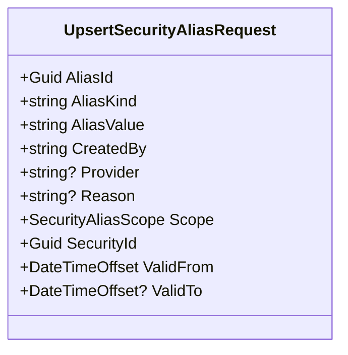

<!-- Generated by build/scripts/schema-control.py. Do not edit directly. -->

# `security-master-contracts` data objects - page 7 of 7

Objects 481-481 of 481. References crossing pages remain available in the dependency manifest.

