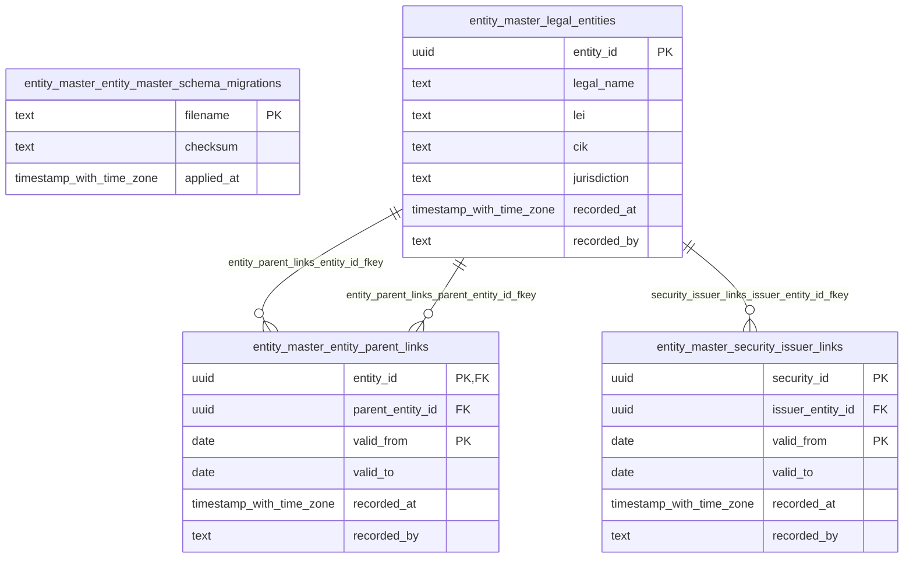

<!-- Generated by build/scripts/schema-control.py. Do not edit directly. -->

# `entity_master` schema

- Relations: 4
- Functions/procedures: 0
- Triggers: 0
- Row-level security policies: 0

The SQL migrations and the PostgreSQL catalog are authoritative. Object identifiers and hashes are normalized for review.

| Relation | Kind | Columns | Primary key | Foreign keys | Indexes | Comment |
| --- | --- | ---: | --- | ---: | ---: | --- |
| `entity_master_schema_migrations` | table | 3 | `filename` | 0 | 1 | - |
| `entity_parent_links` | table | 6 | `entity_id`, `valid_from` | 2 | 2 | ADR-033 direct-parent relationships with valid-time windows [valid_from, valid_to). |
| `legal_entities` | table | 7 | `entity_id` | 0 | 3 | ADR-033 entity master: legal entities keyed by entity_id; LEI and CIK are optional unique external identifiers. |
| `security_issuer_links` | table | 6 | `security_id`, `valid_from` | 1 | 2 | ADR-033 Security Master issuer links (security_id from the Security Master) with valid-time windows. |
