<!-- Generated by build/scripts/schema-control.py. Do not edit directly. -->

# `fund_structure` schema

- Relations: 23
- Functions/procedures: 5
- Triggers: 18
- Row-level security policies: 0

The SQL migrations and the PostgreSQL catalog are authoritative. Object identifiers and hashes are normalized for review.

```mermaid
erDiagram
    fund_structure_business {
        uuid business_id PK
        uuid organization_id
        text business_kind
        text code
        text name
        text base_currency
        boolean is_active
        timestamp_with_time_zone effective_from
        timestamp_with_time_zone effective_to
        jsonb client_ids
        jsonb fund_ids
        jsonb investment_portfolio_ids
        text description
        timestamp_with_time_zone updated_at
        text tenant_id
    }
    fund_structure_client {
        uuid client_id PK
        uuid business_id
        text code
        text name
        text base_currency
        boolean is_active
        timestamp_with_time_zone effective_from
        timestamp_with_time_zone effective_to
        jsonb investment_portfolio_ids
        text description
        text client_segment_kind
        timestamp_with_time_zone updated_at
        text tenant_id
    }
    fund_structure_entity_lifecycle_legacy_baseline {
        uuid entity_id PK,FK
        text lifecycle_status
        timestamp_with_time_zone captured_at_utc
    }
    fund_structure_entity_lifecycle_revision {
        text tenant_id PK
        uuid entity_id PK,FK
        bigint revision PK
        timestamp_with_time_zone recorded_at_utc
        text recorded_by
        text content_hash
        text previous_hash
        jsonb payload
    }
    fund_structure_fund {
        uuid fund_id PK
        uuid business_id
        text code
        text name
        text base_currency
        boolean is_active
        timestamp_with_time_zone effective_from
        timestamp_with_time_zone effective_to
        jsonb sleeve_ids
        jsonb vehicle_ids
        jsonb entity_ids
        jsonb investment_portfolio_ids
        jsonb account_ids
        text description
        timestamp_with_time_zone updated_at
        text tenant_id
    }
    fund_structure_fund_structure_assignment {
        uuid assignment_id PK
        uuid node_id
        text assignment_type
        text assignment_reference
        timestamp_with_time_zone effective_from
        timestamp_with_time_zone effective_to
        boolean is_primary
        timestamp_with_time_zone updated_at
        text tenant_id
    }
    fund_structure_fund_structure_legacy_import_receipt {
        text source_hash PK
        timestamp_with_time_zone imported_at
        integer entity_count
    }
    fund_structure_fund_structure_linked_account {
        uuid account_id PK
        timestamp_with_time_zone updated_at
        text tenant_id
    }
    fund_structure_fund_structure_schema_migrations {
        text filename PK
        text checksum
        timestamp_with_time_zone applied_at
    }
    fund_structure_fund_structure_tenant_backfill_receipt {
        uuid run_id PK
        text plan_hash
        text operator_id
        text review_reference
        timestamp_with_time_zone applied_at_utc
        integer stamped_rows
        integer quarantined_rows
        jsonb plan
    }
    fund_structure_fund_structure_tenant_quarantine {
        uuid node_id PK
        text node_kind
        text reason
        jsonb candidate_tenant_ids
        timestamp_with_time_zone detected_at_utc
        timestamp_with_time_zone resolved_at_utc
        text resolved_tenant_id
        text resolution_note
    }
    fund_structure_intercompany_accounting_arrangement_events {
        text tenant_id PK
        uuid arrangement_id PK
        bigint aggregate_version PK
        uuid request_id
        jsonb payload
    }
    fund_structure_intercompany_agreement {
        text tenant_id PK,FK
        uuid agreement_id PK,FK
        bigint aggregate_version FK
    }
    fund_structure_intercompany_agreement_audit {
        text tenant_id PK,FK
        uuid agreement_id PK,FK
        integer sequence_number PK
        jsonb payload
    }
    fund_structure_intercompany_agreement_command_receipt {
        text tenant_id PK,FK
        uuid agreement_id PK,FK
        uuid command_id PK
        jsonb payload
    }
    fund_structure_intercompany_agreement_revision {
        text tenant_id PK,FK
        uuid agreement_id PK,FK
        integer agreement_version PK
        jsonb payload
    }
    fund_structure_intercompany_agreement_snapshot {
        text tenant_id PK,FK
        uuid agreement_id PK,FK
        bigint aggregate_version PK
        jsonb payload
        timestamp_with_time_zone retained_at_utc
    }
    fund_structure_investment_portfolio {
        uuid investment_portfolio_id PK
        uuid business_id
        text code
        text name
        text base_currency
        boolean is_active
        timestamp_with_time_zone effective_from
        timestamp_with_time_zone effective_to
        uuid client_id
        uuid fund_id
        uuid sleeve_id
        uuid vehicle_id
        uuid entity_id
        jsonb account_ids
        text description
        timestamp_with_time_zone updated_at
        text tenant_id
    }
    fund_structure_legal_entity {
        uuid entity_id PK
        text entity_type
        text legal_form
        text lifecycle_status
        text code
        text name
        text jurisdiction
        text base_currency
        boolean is_active
        timestamp_with_time_zone effective_from
        timestamp_with_time_zone effective_to
        text registration_number
        jsonb beneficial_owners
        jsonb lifecycle_events
        text description
        timestamp_with_time_zone updated_at
        text tenant_id
    }
    fund_structure_organization {
        uuid organization_id PK
        text code
        text name
        text base_currency
        boolean is_active
        timestamp_with_time_zone effective_from
        timestamp_with_time_zone effective_to
        jsonb business_ids
        text description
        timestamp_with_time_zone updated_at
        text tenant_id
    }
    fund_structure_ownership_link {
        uuid ownership_link_id PK
        uuid parent_node_id
        uuid child_node_id
        text relationship_type
        numeric_18_8_ ownership_percent
        boolean is_primary
        timestamp_with_time_zone effective_from
        timestamp_with_time_zone effective_to
        text notes
        timestamp_with_time_zone updated_at
        text tenant_id
    }
    fund_structure_sleeve {
        uuid sleeve_id PK
        uuid fund_id
        text code
        text name
        text mandate
        boolean is_active
        timestamp_with_time_zone effective_from
        timestamp_with_time_zone effective_to
        jsonb strategy_ids
        jsonb investment_portfolio_ids
        jsonb account_ids
        timestamp_with_time_zone updated_at
        text tenant_id
    }
    fund_structure_vehicle {
        uuid vehicle_id PK
        uuid fund_id
        uuid legal_entity_id
        text code
        text name
        text base_currency
        boolean is_active
        timestamp_with_time_zone effective_from
        timestamp_with_time_zone effective_to
        jsonb investment_portfolio_ids
        jsonb account_ids
        text description
        timestamp_with_time_zone updated_at
        text tenant_id
    }
    fund_structure_intercompany_agreement ||--o{ fund_structure_intercompany_agreement_audit : "intercompany_agreement_audit_tenant_id_agreement_id_fkey"
    fund_structure_intercompany_agreement ||--o{ fund_structure_intercompany_agreement_command_receipt : "intercompany_agreement_command_rece_tenant_id_agreement_id_fkey"
    fund_structure_intercompany_agreement ||--o{ fund_structure_intercompany_agreement_revision : "intercompany_agreement_revision_tenant_id_agreement_id_fkey"
    fund_structure_intercompany_agreement ||--o{ fund_structure_intercompany_agreement_snapshot : "intercompany_agreement_snapshot_tenant_id_agreement_id_fkey"
    fund_structure_intercompany_agreement_snapshot ||--o{ fund_structure_intercompany_agreement : "intercompany_agreement_snapshot_pointer"
    fund_structure_legal_entity ||--o{ fund_structure_entity_lifecycle_legacy_baseline : "entity_lifecycle_legacy_baseline_entity_id_fkey"
    fund_structure_legal_entity ||--o{ fund_structure_entity_lifecycle_revision : "entity_lifecycle_revision_entity_id_fkey"
```

| Relation | Kind | Columns | Primary key | Foreign keys | Indexes | Comment |
| --- | --- | ---: | --- | ---: | ---: | --- |
| `business` | table | 15 | `business_id` | 0 | 2 | - |
| `client` | table | 13 | `client_id` | 0 | 2 | - |
| `entity_lifecycle_legacy_baseline` | table | 3 | `entity_id` | 1 | 1 | - |
| `entity_lifecycle_revision` | table | 8 | `tenant_id`, `entity_id`, `revision` | 1 | 1 | - |
| `fund` | table | 16 | `fund_id` | 0 | 2 | - |
| `fund_structure_assignment` | table | 9 | `assignment_id` | 0 | 3 | - |
| `fund_structure_legacy_import_receipt` | table | 3 | `source_hash` | 0 | 1 | - |
| `fund_structure_linked_account` | table | 3 | `account_id` | 0 | 2 | - |
| `fund_structure_schema_migrations` | table | 3 | `filename` | 0 | 1 | - |
| `fund_structure_tenant_backfill_receipt` | table | 8 | `run_id` | 0 | 1 | Immutable receipts binding an explicit tenant-backfill run to its reviewed plan hash, operator, review reference, and atomically committed attribution and quarantine counts. |
| `fund_structure_tenant_quarantine` | table | 8 | `node_id` | 0 | 2 | Fund-structure nodes the W9-GOV-008 tenant attribution declined to attribute: MixedOwnership for a genuinely shared ancestor whose descendants resolve to more than one tenant, Underivable for a node the fund_profile_tenancy registry cannot reach in either direction. Rows here are an operator decision, not a defect - resolving one records the chosen tenant and the reason. |
| `intercompany_accounting_arrangement_events` | table | 5 | `tenant_id`, `arrangement_id`, `aggregate_version` | 0 | 2 | - |
| `intercompany_agreement` | table | 3 | `tenant_id`, `agreement_id` | 1 | 1 | - |
| `intercompany_agreement_audit` | table | 4 | `tenant_id`, `agreement_id`, `sequence_number` | 1 | 1 | - |
| `intercompany_agreement_command_receipt` | table | 4 | `tenant_id`, `agreement_id`, `command_id` | 1 | 2 | - |
| `intercompany_agreement_revision` | table | 4 | `tenant_id`, `agreement_id`, `agreement_version` | 1 | 1 | Approved agreement terms and termination decisions; no historical payload is rewritten. |
| `intercompany_agreement_snapshot` | table | 5 | `tenant_id`, `agreement_id`, `aggregate_version` | 1 | 1 | Immutable command snapshots; the agreement head points to one exact aggregate version. |
| `investment_portfolio` | table | 17 | `investment_portfolio_id` | 0 | 2 | - |
| `legal_entity` | table | 17 | `entity_id` | 0 | 2 | - |
| `organization` | table | 11 | `organization_id` | 0 | 2 | - |
| `ownership_link` | table | 11 | `ownership_link_id` | 0 | 4 | - |
| `sleeve` | table | 13 | `sleeve_id` | 0 | 2 | - |
| `vehicle` | table | 14 | `vehicle_id` | 0 | 2 | - |
