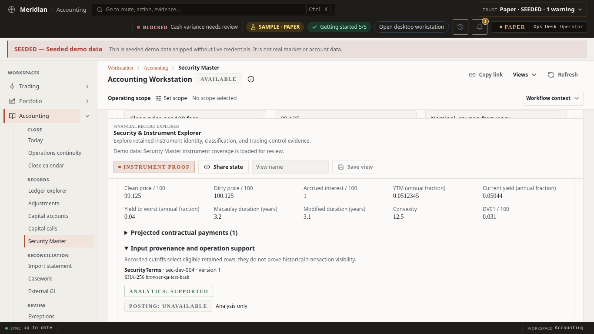
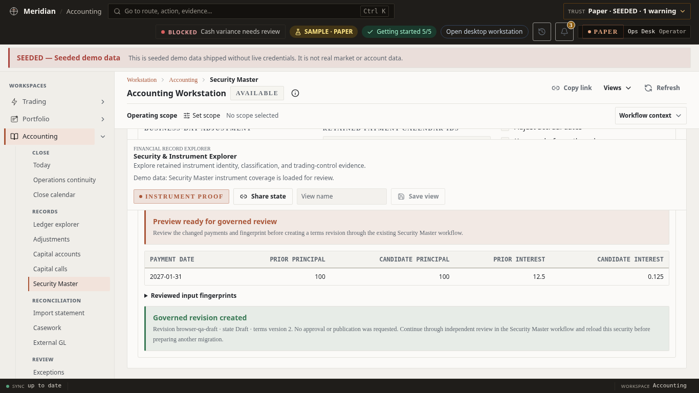

# Bond capability implementation evidence

This increment extends [PR #3328](https://github.com/rodoHasArrived/Meridian-main/pull/3328).
The [implementation and cutover plan](../../../engineering/plans/bond-capability-expansion.md)
defines supported economics and release gates. No customer-data cutover was executed here.

## Numerical and operational proof

Focused suites cover canonical F# terms through calculated projections, declared schedules,
reference mapping and bounded PostgreSQL pages, retained calculation replay, migration inventory
and receipt integrity, settlement consideration, and declared amortization v4. Existing v2/v3
accounting and short opening/cover behavior from the PR remain separately governed.

`BondAnalyticsServiceTests.MicrosoftExcelYieldPublishedExample_MatchesSixPointFivePercent` uses the
published Microsoft Excel YIELD example: 2008-02-15 settlement, 2016-11-15 maturity, 5.75% coupon,
clean price 95.04287, semiannual US 30/360, 100 redemption, expected 6.5% yield and 1.4375 purchased
accrued interest per 100 face. `BondAnalyticsMathTests` independently checks risk sensitivities
against finite differences.

Migration tests cover stale preview/inventory, reviewed per-security blocks, restart deletion and
corruption, hash-bound amendments, immutable prior receipts, and restoration of an older valid
receipt. Live policy checks cover cash-flow projections, Asset Operations, analytics and new
amortization admission; retained reversals and idempotent journal replay preserve their inputs.

Exact aggregate execution results and remaining hosted checks are recorded in the PR description.
The authoritative integration result remains GitHub Actions.

## Browser proof

The actual fixture-only workstation was exercised in Chromium at 1440×900 and 1366×768: select
a bond, calculate analytics, inspect payments and provenance, clear stale results after edits,
preview explicit convention changes, and stage a governed draft with justification. Keyboard
result focus and accessibility automation were checked.

Browser calculation and draft responses were explicitly mocked. Screenshots retain the SEEDED
banner: they prove presentation and interaction, not backend numerical accuracy, live market
data, posting or production cutover.

Native Windows Chrome/Edge verification and installation-specific cutover/reconciliation remain
operator release activities. Development Chromium evidence does not claim those activities ran.
